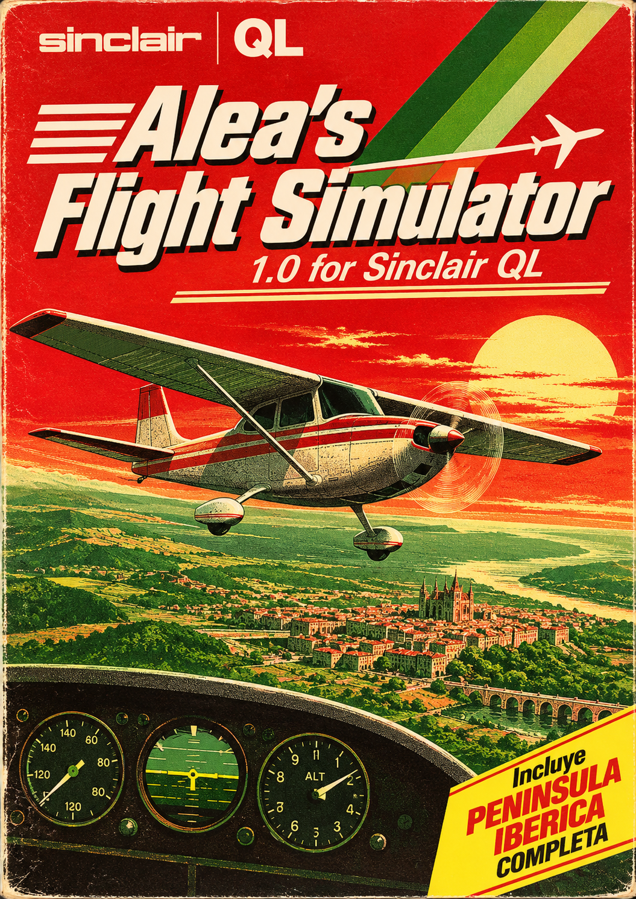
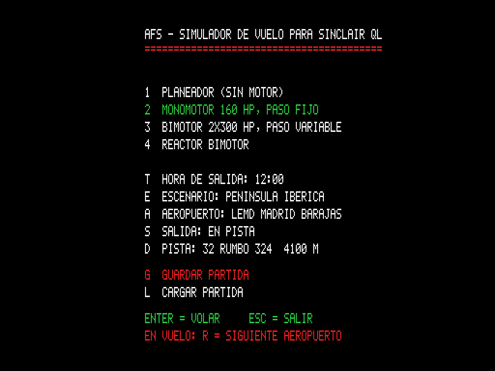
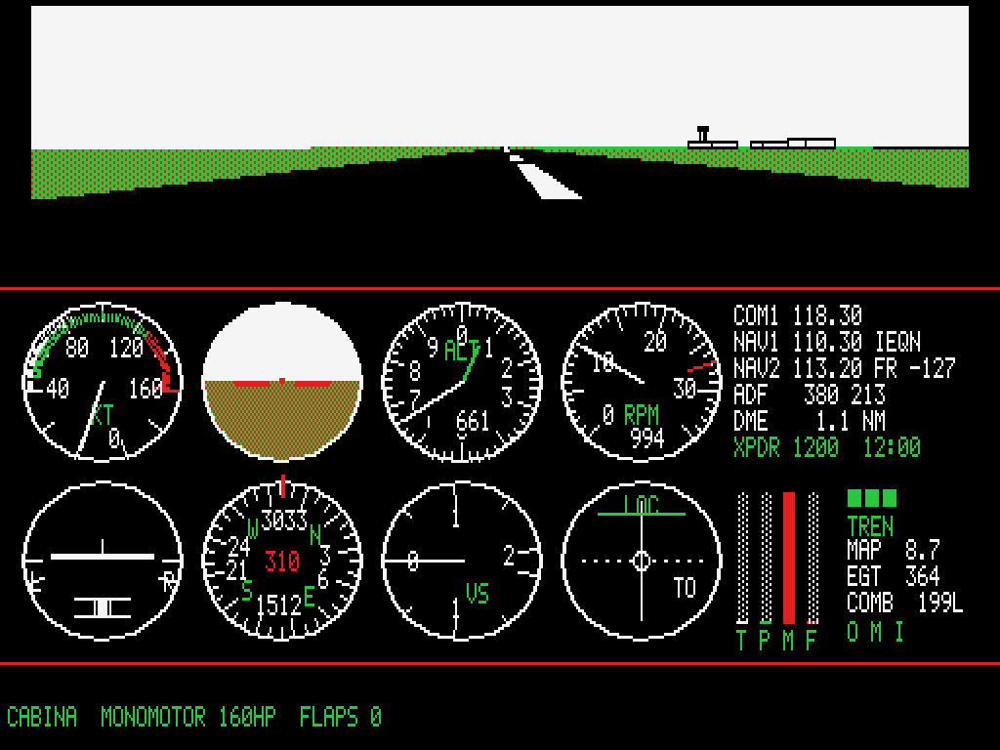
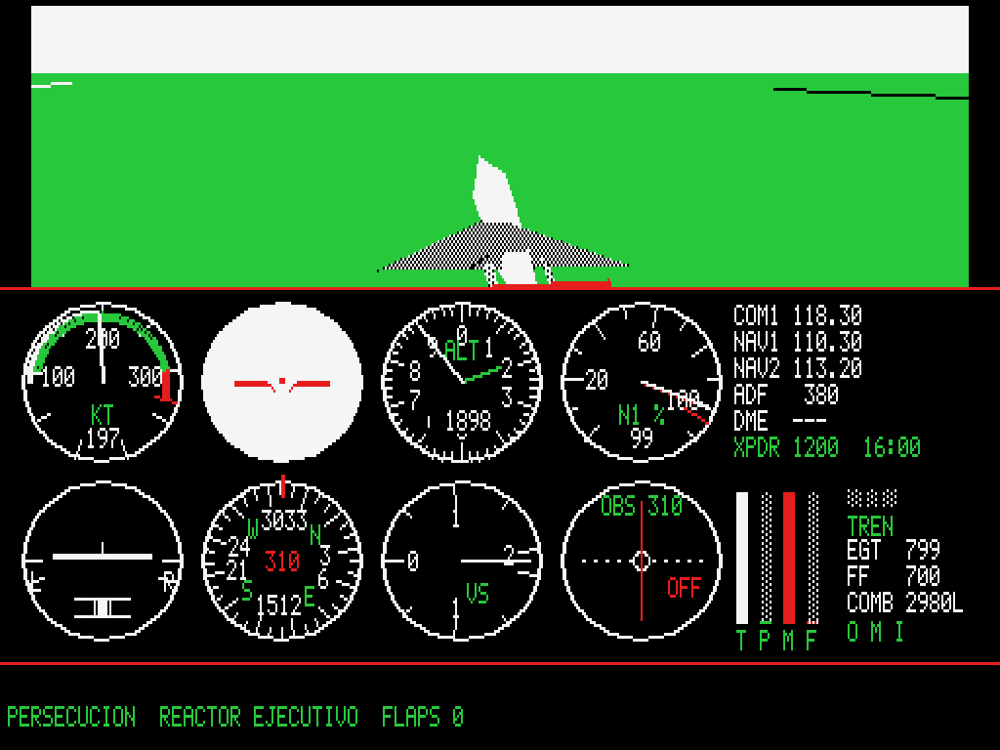
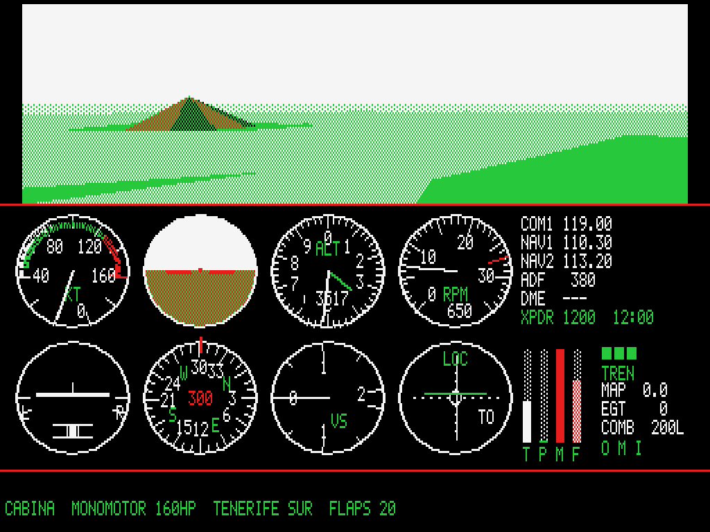
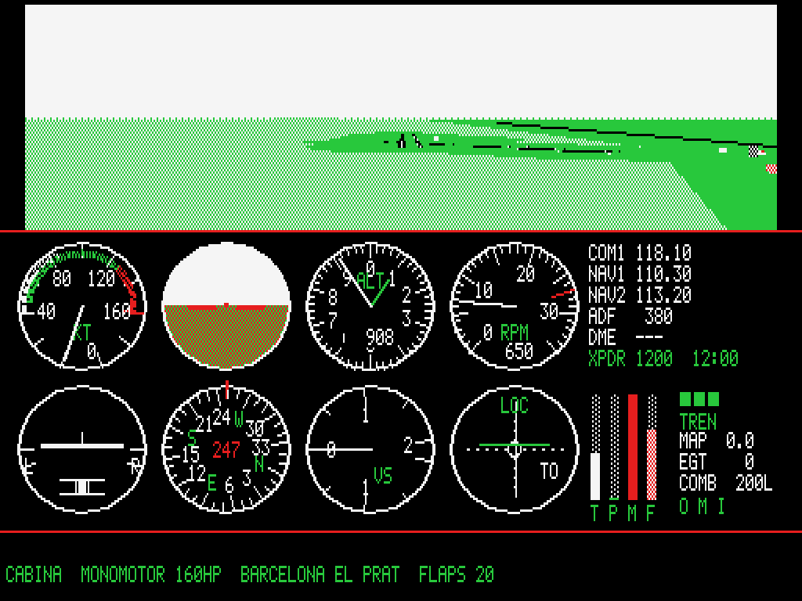
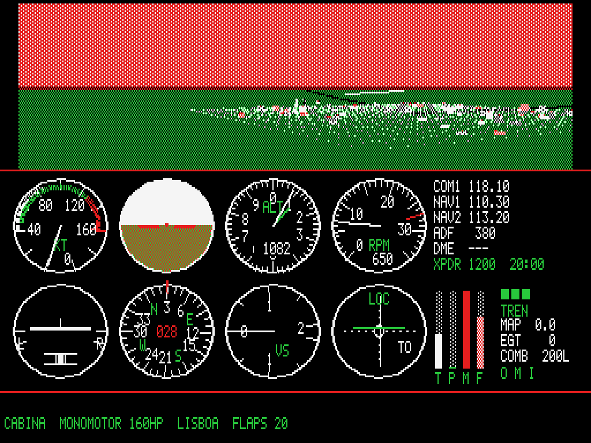
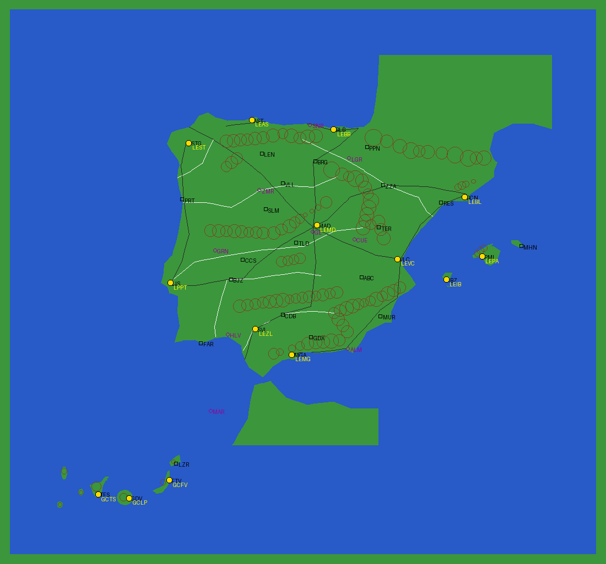

<p align="center">
  
</p>

# Alea's Flight Simulator (AFS)

[](README.en.md)
[](README.md)

> ⚠️ **WARNING:** this program was written by an AI. The human steering, testing and debugging it can't keep up with reviewing everything it generates, so expect bugs (some of them in a party mood). **IMPORTANT:** it is not based on real life; any resemblance to reality is purely coincidental. And no, it won't teach you to fly.

A flight simulator for the **Sinclair QL** (68008 at 7.5 MHz), inspired by the 1982 *Microsoft Flight Simulator 1.0*:
cockpit with instruments, external 3D view and the **whole Iberian Peninsula** to fly over with four aircraft.
Written in C89 for c68/XTC68 (`qcc`), with 68000 assembly in the critical parts, and it runs both on a QL with
expanded memory and on emulators (sQLux, QPC2, QXL…).

## Features

- **Four aircraft** with their own physics (editable `*_acf` files): a glider, a 160 HP single-engine plane, a
  2 × 300 HP twin with variable-pitch propellers and retractable gear, and an executive jet.
- **Iberian Peninsula and the Canary Islands** at 1:2 scale: 14 airports with runways, taxiways, aprons, PAPI and lights,
  about 20 VOR/DME and 9 NDB en route, 33 cities, rivers, motorways, sea and the main mountain ranges. Plus a small
  demonstration "QL Valley". The data is approximate: it is not suitable for real navigation.
- **Radio navigation**: COM1, NAV1, NAV2, ADF, DME, transponder, ILS with localizer and glide slope, VOR with OBS, NDB and
  O-M-I markers.
- **Air traffic control** in English: ATIS, tower, take-off and landing clearances, radar contact.
- **Full panel** in mode 4 (512×256, 4 colours): airspeed indicator with arcs, artificial horizon, altimeter, RPM/N1,
  turn coordinator, heading compass, vertical speed indicator, CDI, radios, levers, engine and gear.
- **3D view** from the cockpit, chase, tower and side, with time of day (day, dusk, night with runway and city lights),
  horizon haze, 40 km visibility and a top-down **map** of the whole scenery.
- **Realistic flight**: stall, gear, flaps, mixture, trim, engine failure, structural failure and crashes; start on the
  runway, on the apron, in the air or on final; save and load games.
- **Sound** with QSound 2+ (AY-3-8910): engine and warnings.
- **Performance designed for the QL**: fixed-point arithmetic, assembly routines, a scenery tile cache, stack and heap in
  RAM free of video contention, and a scheduler that runs the physics at 12.5 Hz inside the 50 Hz interrupt and shares
  out the rest (panel, view, radios) in turns. More in [`doc/optimizacion.md`](doc/optimizacion.md).
- **Documentation**: A5 manual in PDF, aeronautical charts (A3 en-route chart, 39 A5 pages of aerodromes and
  SID/STAR/ILS/VOR procedures, and A4 visual charts). They are generated from the same data as the scenery.

## Requirements

| | To play | To build |
| --- | --- | --- |
| **Machine** | Sinclair QL with Super Gold Card (68020), or an emulator/compatible (sQLux, QPC2, QXL…) at least as fast as a QL ×8 | Linux or similar |
| **Memory** | 640 KB (QL with 512 KB expansion) | |
| **Screen** | Mode 4 (512×256, 4 colours) | |
| **Storage** | 720 KB floppy (`flp1_`) or `win1_` disk (QXL.WIN). No microdrive: the Iberian scenery takes 450 KB | |
| **Keyboard** | The QL's own, or one compatible with the IPC | |
| **Sound** | Optional: QSound 2+. Without it, it runs silently | |
| **Tools** | | `make`, `qcc`/`as68` from XTC68 (the QL), `gcc` and Python 3 (PC, data and tests), `pandoc` + XeLaTeX (manual); for the charts, `reportlab`, `shapely`, poppler and inkscape (`requirements.txt`) |

A QL without memory expansion will not do. On an unaccelerated 7.5 MHz machine the simulator runs, but very slowly
(the panel and the view refresh once or twice per second); from ×8 up the view exceeds 12 frames per second.

## Screenshots

Real mode 4 (512×256) screens, captured from the simulator itself.

| | |
| --- | --- |
|  |  |
| *Start menu: aircraft, scenery, airport, time and start type.* | *Single-engine plane ready for take-off.* |
|  |  |
| *Executive jet in chase view.* | *Teide, from Tenerife South.* |
|  |  |
| *Final approach to Barcelona El Prat.* | *Lisbon at dusk.* |

The whole scenery (airports in yellow, VOR and NDB, motorways and mountain ranges):



## Getting started

```
make                         # full QL build -> build/afs.img (floppy) and build/afs.win (hard disk)
make -f Makefile.pc          # PC: tables, scenery, aircraft, tests and screenshots
make -f Makefile.pc libro    # A5 manual in doc/AFS_Manual_A5.pdf
make -f Makefile.pc cartas   # charts in doc/AFS_*.pdf
make QLANG=en                # the QL build with the main menu in English (src/qfs_en.h); without QLANG, Spanish
make -f Makefile.pc pdf-en   # English edition of the manual and charts in doc/en/AFS_en.pdf
```

On the QL, boot the image (`LRUN flp1_boot` or `LRUN win1_boot`). In sQLux it is enough to add a line
`DEVICE = WIN1,/path/afs.win,qdos-native` to its configuration.

## More information

- [`doc/info.md`](doc/info.md): project status, code structure, `make` targets and what is still to be verified on a real QL.
- [`doc/libro/manual.md`](doc/libro/manual.md): the manual (menus, aircraft, controls, step-by-step flight, ILS/VOR/ADF, air traffic).
- [`doc/optimizacion.md`](doc/optimizacion.md): performance measurements and optimizations.
- [`doc/AFS.pdf`](doc/AFS.pdf): manual and charts in a single PDF (Spanish).
- [`doc/en/`](doc/en): English edition: the manual (`libro/manual_en.md`), charts as SVG (`svg/`) and [`AFS_en.pdf`](doc/en/AFS_en.pdf).

## License

GNU GPL v3 (see [`LICENSE`](LICENSE)).
