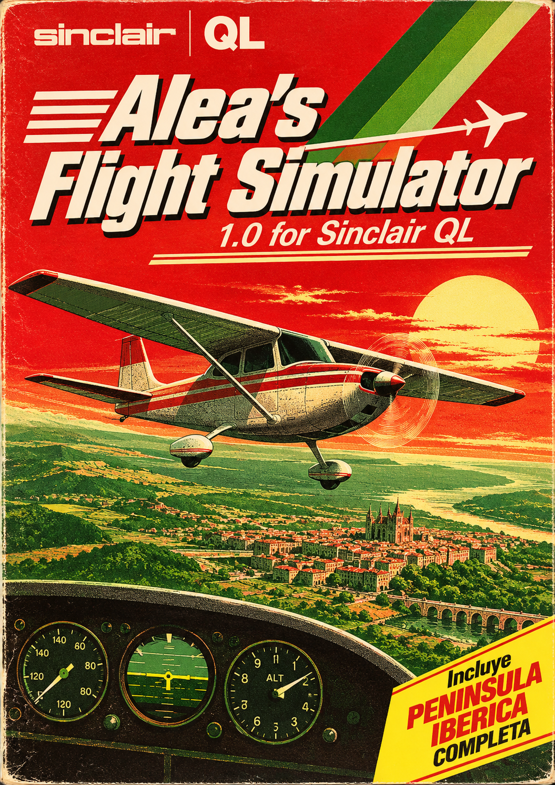
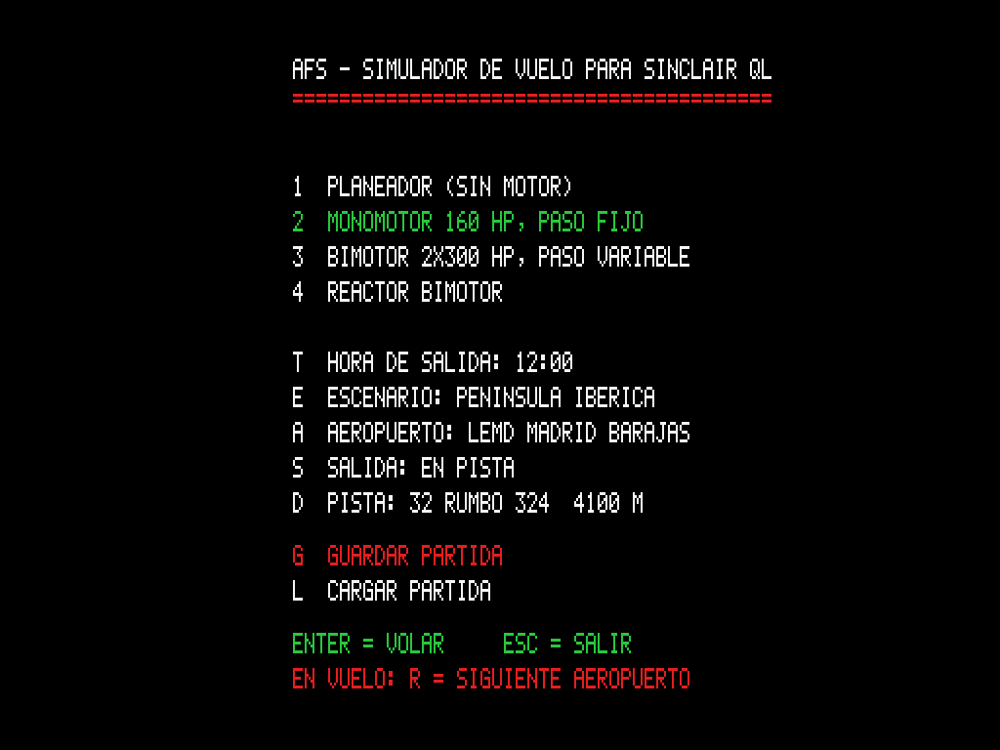
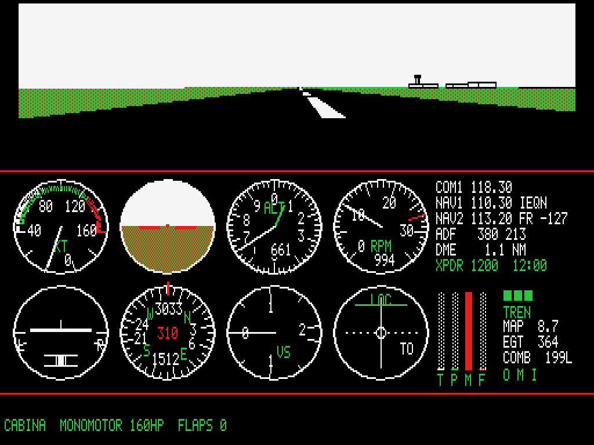
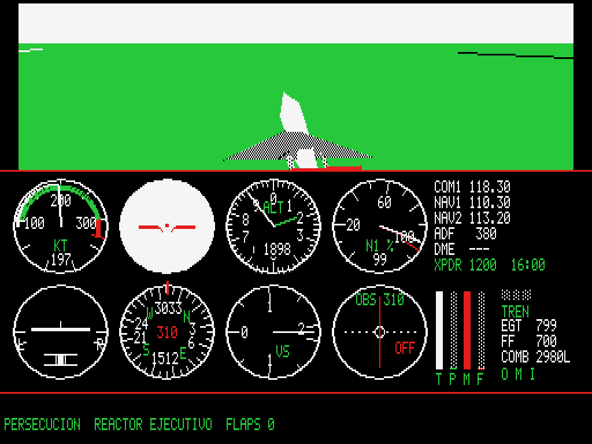
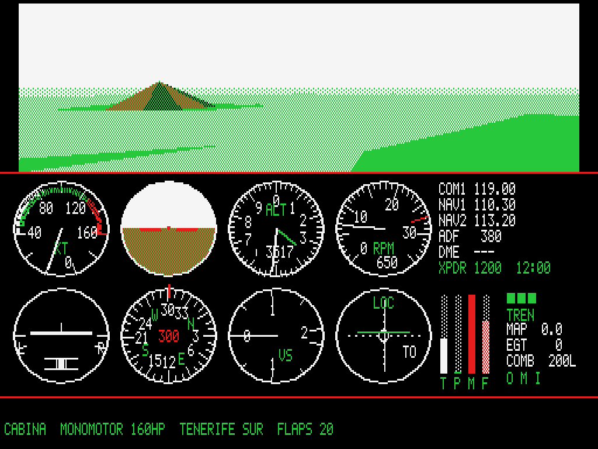
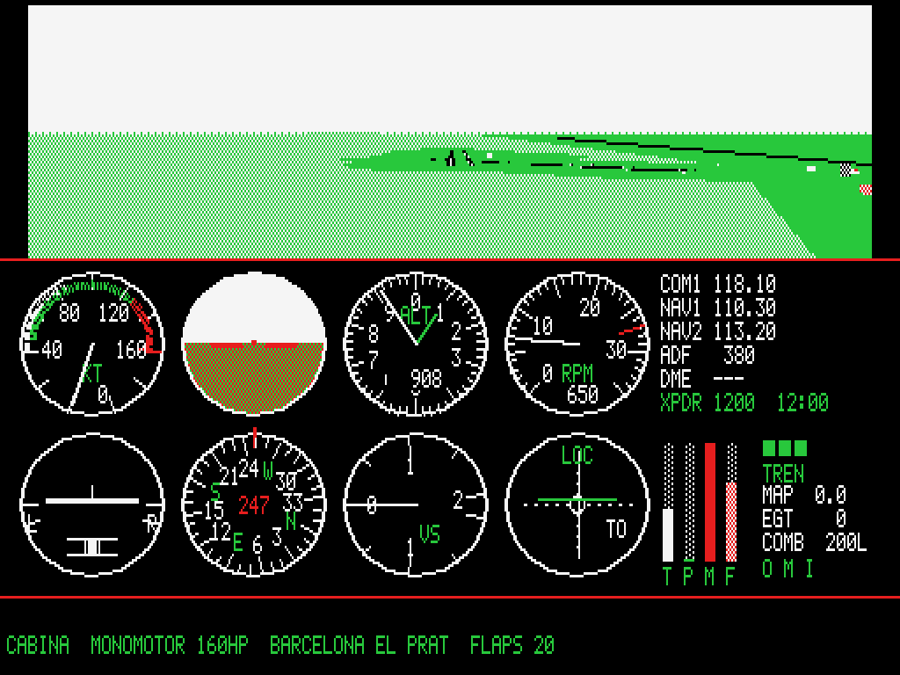
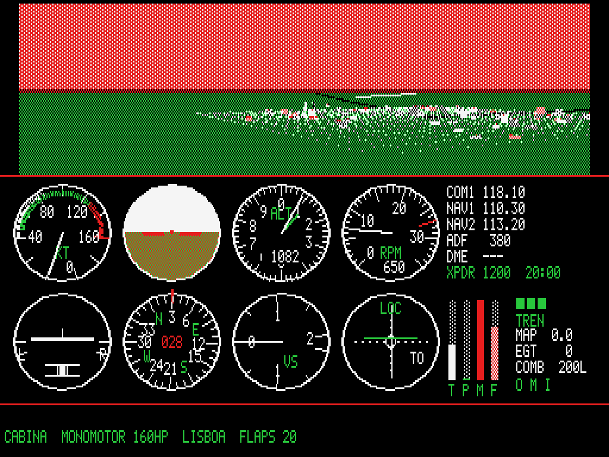
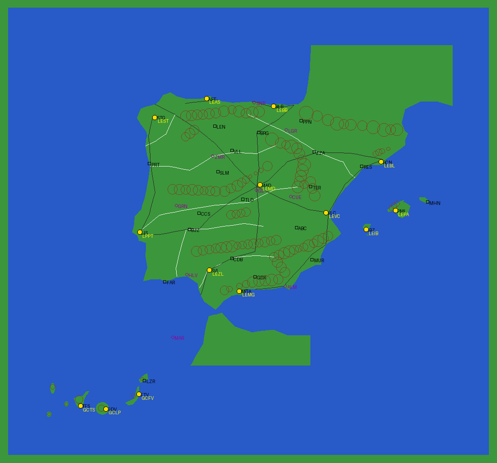

<p align="center">
  
</p>

# Alea's Flight Simulator (AFS)

[](README.en.md)
[](README.md)

> ⚠️ **AVISO:** este programa lo ha escrito una IA. El humano que la dirige, prueba y depura no da abasto para revisar todo lo que genera, así que puede haber bugs (y alguno con ganas de fiesta). **IMPORTANTE:** no está basado en la vida real; cualquier parecido con la realidad es pura coincidencia. Y no, no sirve para aprender a pilotar.

Simulador de vuelo para el **Sinclair QL** (68008 a 7,5 MHz), inspirado en el *Microsoft Flight Simulator 1.0* de 1982:
cabina con instrumentos, vista exterior en 3D y la **Península Ibérica completa** para recorrerla con cuatro aviones.
Escrito en C89 para c68/XTC68 (`qcc`), con ensamblador 68000 en las partes críticas, y funciona tanto en un QL con
ampliación de memoria como en emuladores (sQLux, QPC2, QXL…).

## Características

- **Cuatro aviones** con física propia (ficheros `*_acf` editables): planeador, monomotor de 160 HP, bimotor de
  2 × 300 HP con hélice de paso variable y tren retráctil, y reactor ejecutivo.
- **Península Ibérica y Canarias** a escala 1:2: 14 aeropuertos con pistas, calles de rodaje, plataformas, PAPI y luces,
  unos 20 VOR/DME y 9 NDB en ruta, 33 ciudades, ríos, autovías, mar y los sistemas montañosos principales. Más un pequeño
  «Valle del QL» de demostración. Los datos son aproximados: no sirven para navegar de verdad.
- **Navegación por radio**: COM1, NAV1, NAV2, ADF, DME, transpondedor, ILS con localizador y senda, VOR con OBS, NDB y balizas
  O-M-I.
- **Control de tráfico** en inglés: ATIS, torre, autorizaciones de despegue y aterrizaje, contacto de radar.
- **Panel completo** en modo 4 (512×256, 4 colores): anemómetro con arcos, horizonte artificial, altímetro, RPM/N1,
  coordinador de giro, rosa del rumbo, variómetro, CDI, radios, palancas, motor y tren.
- **Vista 3D** de cabina, persecución, torre y lateral, con hora del día (día, atardecer, noche con luces de pista y
  ciudad), bruma en el horizonte, visibilidad de 40 km y **mapa** cenital de todo el escenario.
- **Vuelo realista**: pérdida, tren, flaps, mezcla, compensador, fallo de motor, rotura estructural y choques; salida en
  pista, en plataforma, en el aire o en final; guardar y cargar partida.
- **Sonido** con QSound 2+ (AY-3-8910): motor y avisos.
- **Rendimiento pensado para el QL**: aritmética de punto fijo, rutinas en ensamblador, caché de teselas del escenario,
  pila y montón en la RAM sin contención del vídeo, y un planificador que corre la física a 12,5 Hz dentro de la
  interrupción de 50 Hz y reparte el resto (panel, vista, radios) por turnos. Más en
  [`doc/optimizacion.md`](doc/optimizacion.md).
- **Documentación**: manual A5 en PDF, cartas aeronáuticas (en ruta A3, 39 páginas de aeródromos y procedimientos
  SID/STAR/ILS/VOR en A5, y cartas visuales A4). Salen de los mismos datos que el escenario.

## Requisitos

| | Para jugar | Para compilar |
| --- | --- | --- |
| **Máquina** | Sinclair QL con Super Gold Card (68020), o emulador/compatible (sQLux, QPC2, QXL…) con al menos la velocidad de un QL ×8 | Linux o similar |
| **Memoria** | 640 KB (QL con 512 KB de ampliación) | |
| **Pantalla** | Modo 4 (512×256, 4 colores) | |
| **Almacenamiento** | Disquete de 720 KB (`flp1_`) o disco `win1_` (QXL.WIN). Sin microdrive: el escenario ibérico ocupa 450 KB | |
| **Teclado** | El del QL o compatible con IPC | |
| **Sonido** | Opcional: QSound 2+. Sin ella, funciona en silencio | |
| **Herramientas** | | `make`, `qcc`/`as68` de XTC68 (el QL), `gcc` y Python 3 (PC, datos y pruebas), `pandoc` + XeLaTeX (manual); para las cartas, `reportlab`, `shapely`, poppler e inkscape (`requirements.txt`) |

El QL sin ampliación de memoria no vale. En una máquina de 7,5 MHz sin acelerar el simulador va, pero muy despacio
(el panel y la vista se refrescan una o dos veces por segundo); desde ×8 la vista pasa de los 12 cuadros por segundo.

## Capturas

Pantallas reales en modo 4 (512×256), capturadas del propio simulador.

| | |
| --- | --- |
|  |  |
| *Menú de salida: avión, escenario, aeropuerto, hora y tipo de salida.* | *Monomotor listo para el despegue.* |
|  |  |
| *Reactor ejecutivo en vista de persecución.* | *El Teide, desde Tenerife Sur.* |
|  |  |
| *Final a Barcelona El Prat.* | *Lisboa al atardecer.* |

El escenario completo (aeropuertos en amarillo, VOR y NDB, autovías y cadenas montañosas):



## Cómo empezar

```
make                         # QL completo -> build/afs.img (disquete) y build/afs.win (disco duro)
make -f Makefile.pc          # PC: tablas, escenario, aviones, pruebas y capturas
make -f Makefile.pc libro    # manual A5 en doc/AFS_Manual_A5.pdf
make -f Makefile.pc cartas   # cartas en doc/AFS_*.pdf
make QLANG=en                # el QL con el menú principal en inglés (src/qfs_en.h); sin QLANG, español
make -f Makefile.pc pdf-en   # edición inglesa del manual y las cartas en doc/en/AFS_en.pdf
```

En el QL, arranca la imagen (`LRUN flp1_boot` o `LRUN win1_boot`). En sQLux basta con una línea
`DEVICE = WIN1,/ruta/afs.win,qdos-native` en su configuración.

## Más información

- [`doc/info.md`](doc/info.md): estado del proyecto, estructura del código, órdenes de `make` y pendiente de verificar en un QL real.
- [`doc/libro/manual.md`](doc/libro/manual.md): el manual (menús, aviones, mandos, vuelo paso a paso, ILS/VOR/ADF, tráfico aéreo).
- [`doc/optimizacion.md`](doc/optimizacion.md): mediciones y optimizaciones de rendimiento.
- [`doc/AFS.pdf`](doc/AFS.pdf): manual y cartas en un solo PDF.
- [`doc/en/`](doc/en): edición inglesa: manual (`libro/manual_en.md`), cartas en SVG (`svg/`) y [`AFS_en.pdf`](doc/en/AFS_en.pdf).

## Licencia

GNU GPL v3 (ver [`LICENSE`](LICENSE)).
