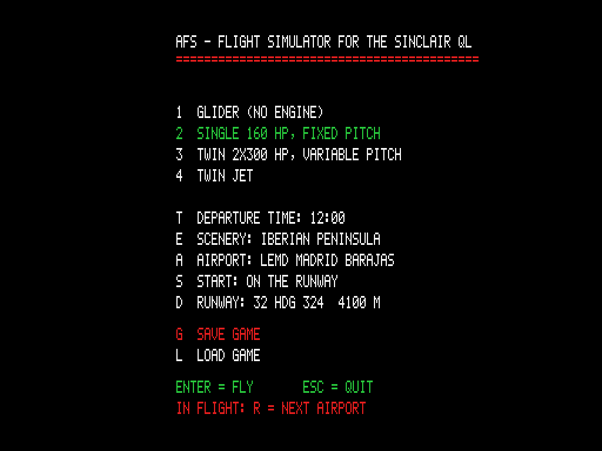
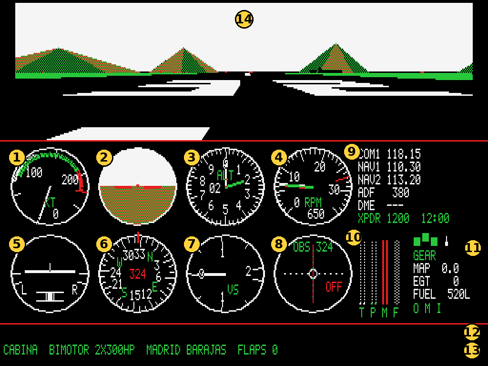
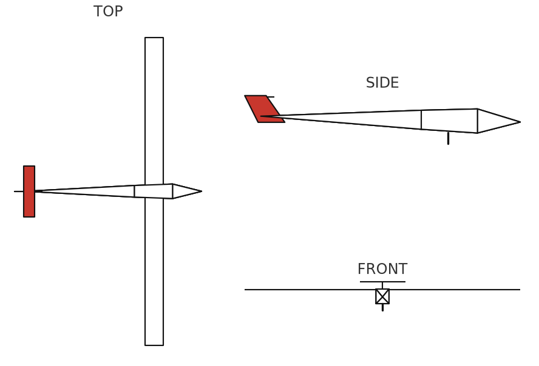
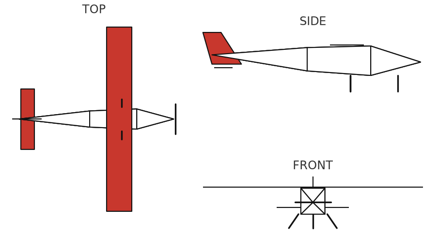
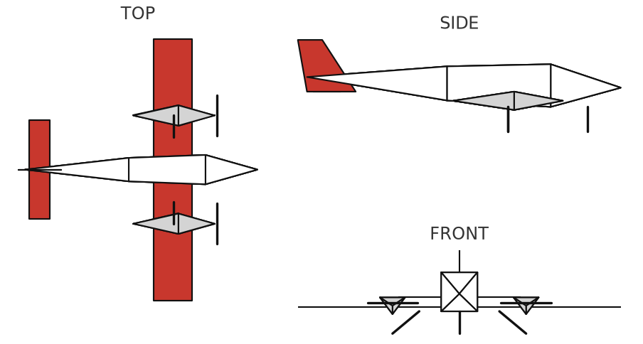
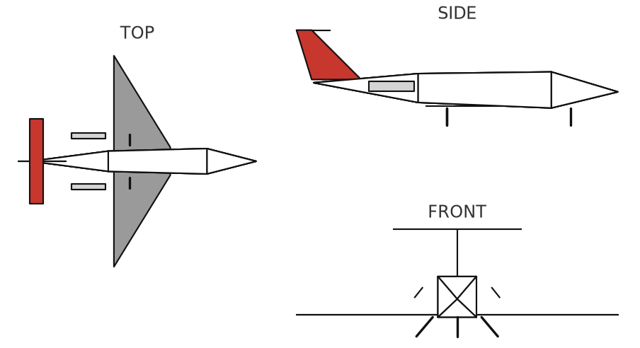
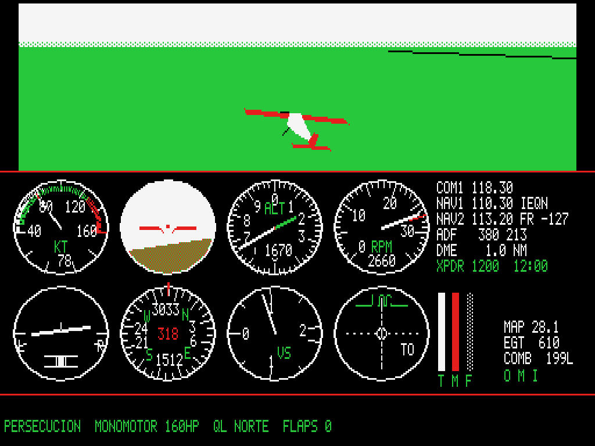

# Getting started {#cap-inicio}

Alea's Flight Simulator (AFS) is a flight simulator for the Sinclair QL. It gives you four aircraft (a glider, a single-engine plane, a twin and a business jet) and two sceneries: a small test valley and the Iberian Peninsula with its fourteen main airports, radio aids, cities and mountains.

This chapter explains the bare minimum to get it running. The following ones describe the menus, the aircraft and how to fly; at the end of the book, in the appendix, you will find the checklists for each aircraft.

## What you need

| Item | Requirement |
|:-------------|:-------------------------------------------------|
| Computer | Sinclair QL fitted with a Super Gold Card (68020), or an emulator/compatible: sQLux, QPC2, QXL... running at least x8 the speed of a standard QL |
| Memory | At least 640 KB (QL with a 512 KB expansion). |
| Display | Mode 4: 512×256 pixels and 4 colours (black, red, green and white) |
| Storage | Double-density floppy (720 KB) in `flp1_`, or a hard disk/QXL.WIN image in `win1_`. Not suited to microdrive: the Iberian scenery takes 450 KB. |
| Keyboard | The QL's own, or an IPC-compatible one. |
| Sound (optional) | QSound 2+ card (AY-3-8910 chip). Without it the simulator runs silently. |

## What is on the disk

The game comes as two images with the same contents: `qfs.img` (720 KB floppy) and `qfs.win` (4 MB hard disk).

| File | Contents |
|:-----------|:---------------------------------------------|
| `boot` | SuperBASIC start-up program (4 lines). |
| `qfs` | The simulator (executable, 67 KB). |
| `iberia_scn` | Iberian Peninsula scenery (450 KB). |
| `demo_scn` | "QL Valley" test scenery (19 KB). |
| `planeador_acf`, `mono_acf`, `bimotor_acf`, `reactor_acf` | The four aircraft (glider, single, twin, jet). They are text files that can be edited. |
| `planeador_src`, `mono_src`, `bimotor_src`, `reactor_src` | Panel background of each aircraft (RAW screen dump format). |
| `<name>_sav` | Saved games, written with **G** in the menu, one per name (they appear as you save). |

## Loading from floppy

1. Put the floppy in drive 1 (`flp1_`).
2. With a disk interface that boots from `flp1_`, just reset the QL and press **F1** (monitor) or **F2** (television): the `boot` file runs by itself.
3. If your interface does not boot by itself, type:

```
LRUN flp1_boot
```

The program sets the QL to mode 4, loads the simulator and shows the menu. Loading takes a few seconds.

## Loading from hard disk or QXL.WIN

With the `qfs.win` image mounted as `win1_` (for example in an emulator, or copied to a hard disk), type:

```
LRUN win1_boot
```

In sQLux you only need to add a line like `DEVICE = WIN1,/path/qfs.win,qdos-native` to the configuration file.

## Loading from another drive

The game looks for its data on the drive given by the `D$` variable in the `boot` file. If you copy the files to another drive (`flp2_`, `ram1_`, `win2_`...), edit `boot` changing the same two lines:

```
100 REMark AFS - flight simulator
110 D$ = "flp1_"
120 MODE 4
130 EXEC_W flp1_qfs
```

Replace `flp1_` with your drive in lines 110 and 130.

::: {.aviso}
**Compatibility:** Toolkit II is not needed; since it uses the `D$` variable it works with any ROM combination.
:::

## If something goes wrong

The simulator's error messages are in Spanish; the English version translates the main menu only.

| Symptom | Probable cause |
|:-------------------------|:---------------------------------------------|
| "NO SE PUEDE ABRIR EL ESCENARIO" (cannot open the scenery) | `iberia_scn` or `demo_scn` is missing on the drive given by `D$`. |
| "NO SE PUEDE LEER EL AVIÓN" (cannot read the aircraft) | One of the `*_acf` files is missing. |
| "FALTA EL FICHERO DEL PANEL (.SRC)" (panel file missing) | The `*_src` file of the chosen aircraft is missing: the panel comes out black. |
| "NO SE PUDO GUARDAR / CARGAR LA PARTIDA" (could not save / load the game) | Disk full or write-protected; or the chosen saved game comes from another machine or version. |
| The QL stays blank when running | Check that line 130 of `boot` points to the right drive. |
| Colours look different | Check that the QL is in mode 4 (`boot` does this with `MODE 4`). |

\newpage

# Menus and options {#cap-menus}

## The main menu

On start-up the departure menu appears. Everything is controlled from the keyboard and the screen updates with each key press.

{width=100%}

| Key | Option |
|:----------------|:-------------------------------------------------------|
| **1** | Glider (no engine). |
| **2** | Single-engine 160 HP, fixed-pitch propeller. This is the default aircraft. |
| **3** | Twin 2×300 HP, variable-pitch propeller and retractable gear. |
| **4** | Twin business jet. |
| **T** / **Shift+T** | Departure time: moves one hour forward or back. Default is 12:00. |
| **E** | Scenery: switches between "Iberian Peninsula" (default) and "QL Valley (demo)". |
| **A** / **Shift+A** | Departure airport. |
| **S** / **Shift+S** | Start type: "Continue flight" (only when returning from a flight, and it is the option left selected; if you change aircraft with 1-4, the flight carries on with the new aircraft, in the same position and attitude), on the runway, on the ramp (the first apron defined in the scenery; if it has none, next to the runway), airborne (random, at 33 % of the ceiling) or landing. |
| **D** / **Shift+D** | On the runway: threshold. Landing: point on the 3° glide path to the runway (at 20 NM, IF at 10 NM, FAF at 5 NM and "short final", at 1.5 NM) and, after those of one runway, the next threshold. The aircraft starts at gliding speed, with gear and flaps up. |
| **G** | Saves the current flight to disk. It asks for a name (up to 8 letters or digits; **←** deletes, **ENTER** saves, **ESC** cancels) and creates the file `<name>_sav`. If a saved game with that name already exists, it asks whether to overwrite it (**Y** yes, **N** no, **ESC** cancels). There is only a flight to save if you came back to the menu from one. |
| **L** | Lists the saved games on the data disk on screen (alphabetically); choose one with **↑** and **↓**, **ENTER** loads it and carries on flying from it, **ESC** returns to the menu. The file is only valid on the same machine and version. |
| **ENTER** | Fly. |
| **ESC** | Quit to SuperBASIC. |

The chosen aircraft is shown in green. After ENTER the program loads the scenery and the aircraft; if a file is missing, it shows a warning in red and returns to the menu.

## Time and light

The departure time (and the one that then advances during the flight) changes the look of the sky and the ground:

| Time | Light |
|:-------------|:-------------------|
| 07:00 – 18:59 | Day |
| 06:00 – 06:59 and 19:00 – 20:59 | Dusk or dawn |
| 21:00 – 05:59 | Night (runway and city lights come on, and the green taxiway centre-line lights) |

## The sceneries

**Iberian Peninsula.** Fourteen airports with tower, ATIS and ILS, plus about twenty en-route VOR/DMEs, nine NDBs, thirty-three cities, rivers, motorways and the main mountain ranges (Pyrenees, Cantabrian, Central System, Betic, Canary Islands...). You start at the threshold of Madrid-Barajas.

::: {.aviso}
The scenery distances are at 1:2 scale, so flights last half as long. Coordinates, headings and frequencies are approximate and made for playing: **they are not for real navigation**. The terrain is flat by 16 km tiles: each airport is at its own elevation (Madrid, 610 m), and that elevation is kept about 40 km around it and falls to zero outwards.
:::

| ICAO | Airport | Runways | Elev. (m) | ATIS | Tower | ILS (main runway) |
|:--|:--------|:--|--:|:--|:--|:---------|
| LEMD | Madrid Barajas | 32L / 32R | 610 | 118.67 | 118.15 | 109.90 (32R: 111.90) |
| LEBL | Barcelona El Prat | 25R / 25L | 4 | 118.65 | 118.10 | 110.30 (25L: 108.30) |
| LEPA | Palma de Mallorca | 24L / 24R | 8 | 119.42 | 118.30 | 109.70 (24R: 108.10) |
| LEIB | Ibiza | 24 | 7 | 127.05 | 118.80 | 110.90 |
| LEVC | Valencia | 12 | 69 | 125.40 | 118.50 | 110.50 |
| LEMG | Málaga | 13L / 13R | 16 | 118.37 | 118.45 | 109.50 (13R: 111.50) |
| LEZL | Sevilla | 27 | 34 | 127.27 | 118.10 | 109.10 |
| LEST | Santiago | 17 | 370 | 120.62 | 118.75 | 110.70 |
| LEAS | Asturias | 29 | 127 | 118.97 | 118.15 | 109.30 |
| LPPT | Lisboa | 03 | 114 | 124.15 | 118.10 | 110.10 |
| GCTS | Tenerife Sur | 07 | 64 | 118.37 | 119.00 | 108.90 |
| GCFV | Fuerteventura | 01 | 26 | 120.05 | 118.25 | 108.70 |
| GCLP | Gran Canaria | 03L / 03R | 24 | 118.05 | 118.30 | 111.10 (03R: 111.70) |
| LEBB | Bilbao | 12 | 42 | 124.65 | 118.25 | 108.50 |

Madrid, Barcelona, Palma, Málaga and Gran Canaria have two parallel runways, each with its own ILS (the letter L or R is painted next to the runway number). Every airport also has its own VOR/DME, PAPI on all thresholds, and the runway number painted on the ground.

**QL Valley (demo).** A small scenery with three airports for testing: "QL Norte" (with ILS on runway 31), "QL Sur" and the "Aeródromo del Lago" (no ATIS, tower on 122.80). It is very light and loads instantly.

## The flight screen

Pressing ENTER takes you to the cockpit. The screen is split into the outside view (top) and the panel (bottom).

{width=100%}

| No. | Element | What it shows |
|:--|:-----------|:---------------------------------------------------------|
| 1 | Airspeed indicator | Indicated speed in knots. The coloured arcs mark the aircraft's limits (see the next chapter). |
| 2 | Artificial horizon | Aircraft attitude: pitch and bank. |
| 3 | Altimeter | Altitude in feet: digital figure, short green needle (thousands) and long white one (hundreds). |
| 4 | Engine speed | Engine RPM (×100 scale) or N1 % on the jet. Twins have two needles: white (left engine) and red (right). |
| 5 | Turn coordinator | Turn to the left (L) or to the right (R). |
| 6 | Heading indicator | Compass rose and current heading in red. |
| 7 | Vertical speed indicator | Vertical speed in thousands of feet per minute. |
| 8 | CDI / ILS | Lateral deviation (vertical bar) and glide path (horizontal green bar); shows `LOC` or `OBS`, and `TO`, `FR` or `OFF`. |
| 9 | Radios | COM1, NAV1, NAV2, ADF, DME, transponder and the time. |
| 10 | Levers | Bars **T**: throttle, **P**: propeller pitch, **M**: mixture and **F**: flaps. On twins, T, P and M are two thin bars (left and right engine). |
| 11 | Engine and gear | Gear lights, MAP, EGT, fuel (FUEL), markers (O M I) and the `PARADO` (stopped) warning. |
| 12 | Tower messages | ATIS and control text, scrolling. |
| 13 | Status line | View, aircraft, departure airport, flaps and warnings. |
| 14 | Outside view | The 3D scene: cockpit, chase, tower or side. |

**The status line** (13) shows normal information in green, and warnings in red:

| Warning | Meaning |
|:---------------|:-----------------------------------------------------|
| `PERDIDA!` | You are within 2° of the stall angle: the wing is about to stop lifting. |
| `TREN!` | Retractable gear up below 150 m above the ground. |
| `TIMON MANUAL` | Automatic coordination switched off (key **Y**). |
| `PAUSA` | Simulation paused (**TAB**). |
| `PARADO` (panel) | The engine is not running. |

(`PERDIDA` = stall, `TREN` = gear, `TIMON MANUAL` = manual rudder, `PAUSA` = pause, `PARADO` = stopped; these messages are shown in Spanish.)

**The gear lights** (11): three squares. Green: gear down and locked; red: in motion; off: up. On fixed-gear aircraft they are always green.

## During the flight

The menu options cannot be changed in flight, but these can:

| Key | Action |
|:----------------|:-----------------------------------------------|
| **TAB** | Pause. |
| **V** | Change view: cockpit, chase, tower, side. In the outside views the gear of retractable aircraft disappears from the drawing once fully retracted. |
| **Q** | Map: the scenery seen from above, north up, full screen with the aircraft at the centre. It marks NDBs (small circle), VORs (large circle with a radial to the north), ILS (with its approach heading) and airports (runways, TWR and ATIS), with name, frequency and morse. The flight carries on in the background; the map does not update by itself: it is drawn when opened and when the scale changes with **+** / **-**. **Q** returns to the cockpit. |
| **T** / **Shift+T** | Time +1 h / −1 h. |
| **R** / **Shift+R** | Restarts the flight at the threshold of the next / previous airport. |
| **ENTER** | After a crash, restarts the flight. |
| **ESC** | Returns to the departure menu. |

\newpage

# The aircraft {#cap-aviones}

The simulator includes four aircraft. Their data are in text files (`*_acf`), so they can be tweaked or others added: just copy one and change the values.

## Summary

| | Glider | Single | Twin | Jet |
|:--------------|:-------:|:-------:|:-------:|:-------:|
| Key in the menu | 1 | 2 | 3 | 4 |
| Engines | — | 1 piston | 2 piston | 2 jets |
| Power or thrust | — | 119 kW (160 HP) | 2 × 224 kW (300 HP) | 2 × 13 kN |
| Propeller | — | fixed pitch | variable pitch | — |
| Gear | fixed | fixed | retractable | retractable |
| Flaps | airbrakes | 0 · 10 · 20 · 30 | 0 · 15 · 30 | 0 · 15 · 40 |
| Mass | 420 kg | 1000 kg | 2300 kg | 7000 kg |
| Fuel | — | 200 L | 520 L | 3000 L |
| Ceiling | 19 700 ft | 13 800 ft | 19 700 ft | 42 700 ft |

## Airspeed indicator markings

Each aircraft has its own speed arcs on the airspeed indicator (in knots):

* **White arc**: from `VS0` to `VFE`. The flap operating range.
* **Green arc**: from `VS1` to `VNO`. Normal flight.
* **Red arc**: from `VNO` to `VNE`. Smooth air only.
* **Red line**: `VNE`, the speed that must never be exceeded.

| | Glider | Single | Twin | Jet |
|:------------------------|:-----:|:-----:|:-----:|:-----:|
| `VS0` stall, flaps down | 36 | 41 | 70 | 88 |
| `VS1` stall, clean | 38 | 48 | 80 | 102 |
| `VFE` max. with flaps | 110 | 85 | 120 | 200 |
| `VNO` max. normal | 100 | 128 | 195 | 300 |
| `VNE` never exceed | 135 | 160 | 225 | 330 |

::: {.aviso}
If the speed exceeds `VNE` by more than 12 %, the aircraft suffers **structural failure** and the flight ends.
:::

\newpage

## Glider

{width=64%}

A training sailplane: light, long-winged and with very little drag. It has no engine, so flying is a continuous conversion of height into distance. **You start in the air**, 600 m above the ground, at about 58 kt and 4 km before the threshold of the chosen runway; there is no tow or launch.

| Item | Value |
|:-----------------------|:----------------------------|
| Wingspan / length / height | 17.0 m / 10.3 m / 1.8 m |
| Mass | 420 kg |
| Wing area | 13 m² |
| Best glide (measured) | glide ratio ≈ 29, at about 55 kt |
| Best glide (calculated) | maximum glide ratio ≈ 32, at 50 kt |
| Stall | 36 kt with airbrakes; 38 kt clean |
| Airbrakes | Key **F** opens them; **Shift+F** closes them |
| Gear | Fixed |
| Ceiling | 6000 m (19 700 ft) |

**How it behaves.** It responds quickly to the controls and loses little speed in turns. To land, aim at the threshold and regulate the glide path with the airbrakes: open, they greatly increase drag and the descent slope. Any energy error is paid for: with no engine, there is no second chance.

\newpage

## Single-engine 160 HP

{width=64%}

A four-seat high-wing monoplane with a 160 HP piston engine, fixed-pitch propeller and fixed gear. It is the ideal aircraft to start with: stable, forgiving and slow-flying.

| Item | Value |
|:-----------------------|:----------------------------|
| Wingspan / length / height | 11.0 m / 9.7 m / 2.6 m |
| Mass | 1000 kg |
| Wing area | 16.2 m² |
| Engine | Piston, 119 kW (160 HP), 2700 rpm max., idle 650 rpm |
| Fuel | 200 L; consumption 38 L/h at full power (≈ 5 h) |
| Flaps | 0, 10, 20 and 30° |
| Stall | 41 kt with flaps; 48 kt clean |
| Best glide (calculated) | ≈ 75 kt, glide ratio ≈ 13 |
| Take-off run (measured) | ≈ 280 m |
| Climb (measured) | ≈ 1100 ft/min at 77 kt |
| Ceiling | 4200 m (13 800 ft) |

**How it behaves.** With a fixed-pitch propeller, RPM depends on throttle and airspeed: in a dive it rises a lot, so take care not to go past the red mark on the tachometer. The mixture is handled with **M** and **Shift+M**; with the bar at maximum the engine runs rich and comfortable. If the mixture drops too low or the fuel runs out, the engine stops.

\newpage

## Twin 2 × 300 HP

{width=64%}

A light twin with constant-speed propellers and retractable gear. It is faster and more demanding than the single: you have to manage gear, flaps, mixture and propeller pitch.

| Item | Value |
|:-----------------------|:----------------------------|
| Wingspan / length / height | 11.6 m / 10.6 m / 3.0 m |
| Mass | 2300 kg |
| Wing area | 18.5 m² |
| Engines | 2 × piston, 224 kW (300 HP), 2700 rpm max. |
| Propellers | Variable pitch (lever **P**) |
| Fuel | 520 L; 75 L/h per engine at full power (≈ 3.5 h) |
| Flaps | 0, 15 and 30° |
| Gear | Retractable (key **G**) |
| Stall | 70 kt with flaps; 80 kt clean |
| Best glide (calculated) | ≈ 100 kt with gear up, glide ratio ≈ 14 |
| Climb (measured) | ≈ 2500 ft/min at 135 kt |
| Ceiling | 6000 m (19 700 ft) |

**How it behaves.** The throttle, mixture and pitch controls act on both engines at once. Lever **P** is the blade pitch. With fine pitch (empty bar) the propeller loads the engine little: high RPM and maximum thrust at low speed, for take-off and landing, but it performs poorly when fast. Coarsening the pitch (**Shift+P**) lowers the RPM, the engine burns less and the propeller does better in cruise. RPM also depends on throttle and mixture: pitch only sets the ceiling. Raise the gear after take-off and lower it before landing: with the gear up it is a crash.

\newpage

## Business jet

{width=64%}

A business jet with swept wings and tail-mounted engines. It takes off in little over 600 m and climbs at rates a propeller aircraft cannot reach: plan the approach well, because it slows down slowly.

| Item | Value |
|:-----------------------|:----------------------------|
| Wingspan / length / height | 15.0 m / 16.9 m / 5.0 m |
| Mass | 7000 kg |
| Wing area | 30 m² |
| Engines | 2 jets, 13 kN of thrust each |
| Fuel | 3000 L; 700 L/h per engine at full power (≈ 2 h) |
| Flaps | 0, 15 and 40° |
| Gear | Retractable (key **G**) |
| Stall | 88 kt with flaps; 102 kt clean |
| Best glide (calculated) | ≈ 140 kt, glide ratio ≈ 16 |
| Take-off run (measured) | ≈ 650 m |
| Climb (measured) | over 8000 ft/min after take-off |
| Ceiling | 13 000 m (42 700 ft) |

**How it behaves.** Instead of RPM, the panel shows **N1 %** (compressor speed), which is slow to rise and fall: apply power in advance. The engine does not stop through mixture, but with the **cut-off lever** (**M** to zero) or from lack of fuel. On the panel, `EGT` is the exhaust gas temperature and `FF` the fuel flow per engine in litres per hour.

\newpage

# How to fly {#cap-volar}

## The controls

The keyboard is read all at once: you can press several keys simultaneously (for example, roll and pitch). To save time, the cursors, SPACE, ENTER and ESC are read every frame; F1-F4 and M, the full stop and Z, every other frame; and the rest of the keys, one row per frame in rotation (every five frames). Hold the key down for a moment if it does not respond at once.

### Flight controls

| Key | Action |
|:----------------|:-------------------------------------------------------|
| **↑** | Push the stick: nose down. |
| **↓** | Pull the stick: nose up. The control stays where you leave it. |
| **←** / **→** | Roll left / right. On release, the ailerons return to centre. |
| **Z** / **X** | Rudder (left / right), if the rudder is manual. |
| **Y** | Toggles automatic rudder coordination. If switched off, the status line shows `TIMON MANUAL`. |
| **SPACE** | Centres ailerons, rudder and elevator. |
| **[** / **]** | Trim (nose down / up), a little at a time. |

### Engine

| Key | Action |
|:----------------|:-------------------------------------------------------|
| **F1** | Throttle to idle (cut). |
| **F2** | Less throttle, gradually. |
| **F3** | More throttle, gradually. |
| **F4** | Full throttle. |
| **M** / **Shift+M** | Mixture: lean / enrich. At zero, the engine stops. |
| **P** / **Shift+P** | Propeller pitch (twin only): finer (more RPM, more thrust at take-off) / coarser (fewer RPM, better in cruise). |
| **E** | Starter: hold it down (with mixture > 5 % and fuel) to start a stopped engine. **Shift+E** stops the engine (on the ramp you leave with the engine stopped). |

### Aircraft configuration

| Key | Action |
|:----------------|:-------------------------------------------------------|
| **F** | One notch less flap, towards 0 (or closes the glider's airbrakes). |
| **Shift+F** | One notch more flap (or opens the airbrakes). |
| **G** | Raises or lowers the gear (retractable-gear aircraft only). |
| **.** (full stop) | Wheel brakes, while held down. |
| **Shift+.** | Sets or releases the parking brake (you leave the runway and the ramp with it on). **BRK** in red on the panel, to the right of GEAR, with either brake. |

### Views

| Key | Action |
|:----------------|:-------------------------------------------------------|
| **V** | Changes view: cockpit, chase, tower, side. |
| **5** / **4** / **6** / **8** | In the cockpit, look ahead / left / right / behind. |
| **=** / **−** | Zoom: camera closer / farther. |

### Radios and navigation

Each key press changes the frequency by one step; with **Shift** it goes the other way. At the limit, it wraps around.

| Key | Action |
|:----------------|:-------------------------------------------------------|
| **C** | COM1: 118.00 – 136.95 MHz, steps of 0.05. |
| **N** | NAV1: 108.00 – 117.95 MHz, steps of 0.05. |
| **H** | NAV2: 108.00 – 117.95 MHz, steps of 0.05. |
| **A** | ADF: 190 – 1750 kHz, steps of 5 kHz. |
| **O** / **Shift+O** | OBS (VOR course): hold it down to turn it. |
| **K** | Call the tower. |

### Simulation

| Key | Action |
|:----------------|:-------------------------------------------------------|
| **TAB** | Pause. |
| **T** / **Shift+T** | Time +1 h / −1 h. |
| **R** / **Shift+R** | Restarts the flight at the next / previous airport. |
| **\\** (backslash) | Shows or hides the frames-per-second indicator (bottom left). |
| **ENTER** | After a crash, restarts the flight. |
| **ESC** | Exits to the menu. |

## Useful settings

**Automatic coordination (Y).** By default the simulator coordinates the rudder with the ailerons, and on the ground the ailerons (**←** and **→**) steer the nose wheel. If you switch it off with **Y**, the rudder goes to **Z** and **X**, and that is what steers the wheel on the ground.

**Trim.** If you get tired of holding the pitch, correct the attitude and adjust the trim with **[** and **]** until the aircraft flies hands-off.

**Views.** The cockpit view is the working one; **chase**, **tower** and **side** are for seeing the aircraft from outside and for show. Press **V** until you are back in the cockpit before an instrument landing.

**Wind.** It always blows from the north at 6 kt. The tower reports it and chooses the runway in use.

**Visibility.** The Iberian scenery has a visibility of 40 km; beyond that, the ground fades into haze.

{width=85%}

## A flight step by step

**1. Before you move.** Look at the panel: COM1 is already on the tower frequency, and NAV1 is tuned to the runway's ILS if you want to use it. Check mixture, fuel, flaps and trim (see the checklists in the appendix). With the aircraft stopped and the tower tuned, press **K**: "CLEARED FOR TAKEOFF" if you are below 20 kt.

**2. Taxi and take off.** Release the brakes, apply full throttle (**F4**) and hold the runway centre line with **←** and **→**. At your aircraft's rotation speed (see the checklists) pull gently (**↓**) up to about 8–10° of pitch. When the vertical speed indicator shows a climb, raise the gear (**G**, retractable aircraft only).

**3. Climb.** Hold the climb speed with pitch, not with throttle. Retract the flaps on reaching about 400 ft above the terrain and enough speed. Reduce power to climb or cruise power.

**4. Cruise.** Level off, set the power, trim and check the heading with the indicator and the radio aids (VOR, ADF, DME).

**5. Descend and approach.** Reduce power, let the nose drop and tune the ATIS (**C**) to learn the runway in use. With NAV1 on the ILS (**N**), the CDI (8) guides you laterally and on the glide path. At 25 km from the runway press **K**: the tower will ask you to report 5 miles final.

**6. Land.** Lower the gear and flaps in stages below `VFE`. Hold the glide path, reduce to idle as you start the flare and touch down gently: the rate of descent at contact must not exceed 3.5 m/s (about 690 ft/min), with the wings almost level and the nose not below 4° nose-down attitude. Brake with **.** and the tower will greet you: "WELCOME TO… TAXI TO PARKING".

**7. Taxi and stop.** Slow to below 25 kt, leave the runway and brake.

## Navigation instruments

**ILS.** Tune the runway's localiser frequency on NAV1 (see the airports table). The CDI (8) then shows `LOC`: the vertical bar tells you whether you are left or right of the runway, and the horizontal green bar whether you are above or below the 3° glide path. The aim is to keep both bars centred. The DME gives the distance to the airport in nautical miles. Passing over the markers lights the panel's **O** (outer), **M** (middle) and **I** (inner) lights (11).

**VOR.** Tune a VOR on NAV1 or NAV2. The CDI shows `OBS` with the selected course (changed with **O**), the deviation bar, and the flag `TO` (you are approaching the station), `FR` (you are moving away) or `OFF` (no signal).

**ADF.** Tune an NDB with **A**. The panel shows the frequency and the bearing relative to the station (in degrees, relative to the nose).

**Transponder.** Code 1200 (VFR) appears, which the tower repeats on radar contact.

## Air traffic control

The tower and the ATIS speak English, as in real aviation. Their messages scroll along line 12 of the panel.

**ATIS.** Tune an airport's ATIS frequency on COM1 while within 60 km. The message (runway in use, wind, altimeter, ILS) repeats until you change frequency.

**Tower.** Tune the tower frequency on COM1 (it is already set at start) and press **K**:

| Situation | Tower response |
|:-----------------------------|:--------------------------------------------------|
| On the ground, below 20 kt | `CLEARED FOR TAKEOFF` (with runway and wind). |
| On the ground, above 20 kt | `HOLD SHORT, STOP BEFORE CALLING.` |
| In the air, within 9 km, lined up with the runway | `CLEARED TO LAND` |
| In the air, within 9 km, not lined up | `ENTER DOWNWIND, REPORT FINAL.` |
| In the air, 9 to 25 km | `ALTIMETER 2992, REPORT 5 MILES FINAL.` |
| In the air, beyond 25 km (up to 60) | `RADAR CONTACT, SQUAWK …, FLY HEADING …, VECTORS TO …` |
| A frequency that is neither ATIS nor tower | `NO REPLY ON THIS FREQUENCY.` |

There are also automatic messages: `CONTACT DEPARTURE. GOOD DAY.` on leaving the zone after take-off; `WELCOME TO … TAXI TO PARKING.` on landing and slowing below 25 kt, and `YOU WERE NOT CLEARED. CONTACT THE TOWER.` if you accelerate or land without clearance.

## Crashes and restart

The flight ends with a red message and, on pressing **ENTER**, you return to the threshold.

| Message | Cause |
|:-----------------------------------|:-----------------------------------------------|
| `CRASH! - BAJE EL TREN LA PROXIMA VEZ` (lower the gear next time) | Landing with the retractable gear up. |
| `CRASH!` | Ground contact too hard: descent over 3.5 m/s, bank over 12° or nose below −4°. |
| `BUILDING CRASH` | Hitting a building. |
| `MOUNTAIN CRASH` | Hitting a mountain. |
| `SPLASH!` | Touching the water. |
| `ROTURA ESTRUCTURAL - VNE EXCEDIDA` (structural failure, VNE exceeded) | Exceeding `VNE` by more than 12 %. |

\newpage

\appendix
\AtBeginEnvironment{longtable}{\footnotesize}

# Checklists

Each aircraft has seven lists, one per phase: prepare for take-off, take-off, cruise, prepare for landing, landing, taxi and emergencies. The speeds are indicative, calculated from each aircraft's stall speeds (`VS0`, `VS1`) and its limits (`VFE`, `VNO`, `VNE`).

The □ symbol is for ticking with a pencil on paper. Keys appear in **bold**.

\newpage

## Glider

The glider starts already in the air, at about 58 kt and 600 m high, 4 km from the runway: it has no taxi or take-off phases of its own, so its lists are those of the flight.

### Prepare for departure

| | | |
|:-:|:------------------|:-----------------------------|
| □ | Aircraft | **1** in the menu |
| □ | Time | **T**: daylight to start with |
| □ | Airbrakes | Closed (bar **F** empty) |
| □ | Altimeter | Note the height: about 2000 ft |
| □ | Speed | 55 kt, best glide |
| □ | Radio COM1 | On the runway's tower (already set) |
| □ | Radio NAV1 | Runway ILS, if you want to use it |

### Take-off (start of the flight)

| | | |
|:-:|:------------------|:-----------------------------|
| □ | Controls | **SPACE**: centred |
| □ | Attitude | Nose on the horizon |
| □ | Speed | 55–60 kt and steady |
| □ | Trim | Adjust with **[** and **]** until it flies hands-off |
| □ | Surroundings | Look for the runway ahead |

### Cruise

| | | |
|:-:|:------------------|:-----------------------------|
| □ | Speed | 55 kt (best glide); 70–80 kt to go faster |
| □ | Airbrakes | Closed |
| □ | Heading | Towards the runway, with gentle ← and → |
| □ | Height | Watch ALT; the glide ratio is ≈ 29 |
| □ | Limits | Below 100 kt (green arc) |

\newpage

### Prepare for landing

| | | |
|:-:|:------------------|:-----------------------------|
| □ | Tower | **K** within 25 km |
| □ | Circuit | Line up with the runway before 9 km |
| □ | Speed | 60 kt on final |
| □ | Glide path | Aim at a point short of the runway |
| □ | Airbrakes | Have your hand ready on **F** |

### Landing

| | | |
|:-:|:------------------|:-----------------------------|
| □ | Tower | **K**: "CLEARED TO LAND" |
| □ | Airbrakes | **F** if high; **Shift+F** if low |
| □ | Flare | Over the runway, gently raise the nose |
| □ | Touchdown | Under 3.5 m/s, wings level |
| □ | Brakes | **.** (full stop) |

### Taxi

| | | |
|:-:|:------------------|:-----------------------------|
| □ | Airbrakes | Open so as not to become airborne again |
| □ | Brakes | **.** (full stop) until stopped |
| □ | Steering | **←** and **→** (or **Z**/**X** on manual) |
| □ | Tower | "WELCOME TO…" on dropping below 25 kt |

### Emergencies

| | | |
|:-:|:------------------|:-----------------------------|
| □ | Stall (`PERDIDA!`) | **↑**: lower the nose; wings level; close the airbrakes |
| □ | Short of height | Pick the nearest field or the airport |
| □ | No tower | Land on any runway, without waiting |
| □ | Overspeed | Airbrakes open, raise the nose gently |

\newpage

## Single-engine 160 HP

### Prepare for take-off

| | | |
|:-:|:------------------|:-----------------------------|
| □ | Fuel | FUEL ≈ 200 L |
| □ | Mixture | Full (bar **M** full: **Shift+M**) |
| □ | Throttle | **F1**: idle, ≈ 650 rpm |
| □ | Flaps | 10°: **F** once |
| □ | Controls | **SPACE**: centred; trim neutral |
| □ | Heading | Indicator (6) = runway heading |
| □ | Altimeter | Check the field elevation |
| □ | Radios | COM1 on the tower; NAV1 on the ILS |
| □ | ATIS | Listen for runway and wind |
| □ | Brakes | Parking brake (**Shift+.**) while you wait |

### Take-off

| | | |
|:-:|:------------------|:-----------------------------|
| □ | Tower | **K**: "CLEARED FOR TAKEOFF" |
| □ | Brakes | Release the parking brake with **Shift+.**: the red **BRK** goes out |
| □ | Throttle | **F4**: full |
| □ | Runway centre line | **←** and **→** |
| □ | Rotation | 55 kt: gentle **↓**, 8–10° |
| □ | Positive climb | Vertical speed indicator (7) > 0 |
| □ | Climb speed | 75–80 kt |
| □ | Flaps | **Shift+F** at 400 ft AGL and 65 kt |

### Cruise

| | | |
|:-:|:------------------|:-----------------------------|
| □ | Altitude | Level off and trim |
| □ | Power | **F2**: RPM below the red mark (< 2700) |
| □ | Mixture | Rich (bar full) |
| □ | Speed | ≈ 110 kt, within the green arc (48–128 kt) |
| □ | Fuel | Watch FUEL |
| □ | Navigation | VOR/ADF/DME; heading with the indicator (6) |

\newpage

### Prepare for landing

| | | |
|:-:|:------------------|:-----------------------------|
| □ | ATIS | Runway in use and wind |
| □ | Tower | **K** within 25 km |
| □ | Descent | Low throttle, 90 kt until the circuit |
| □ | Mixture | Rich |
| □ | Flaps | 10° at ≤ 85 kt: **F** |
| □ | ILS | NAV1 on the localiser |
| □ | Final | 65 kt, flaps 20° |

### Landing

| | | |
|:-:|:------------------|:-----------------------------|
| □ | Tower | **K**: "CLEARED TO LAND" |
| □ | Flaps | 30° on short final, 60 kt |
| □ | Glide path | 3°: CDI bars centred |
| □ | Throttle | **F1** when you level off |
| □ | Touchdown | ≈ 50 kt, under 3.5 m/s |
| □ | Brakes | **.** (full stop) |

### Taxi

| | | |
|:-:|:------------------|:-----------------------------|
| □ | Flaps | **Shift+F** down to 0 |
| □ | Throttle | Idle; < 25 kt |
| □ | Steering | **←** and **→** |
| □ | Tower | "WELCOME TO… TAXI TO PARKING" |
| □ | Stop | **.** (full stop) |

### Emergencies

| | | |
|:-:|:------------------|:-----------------------------|
| □ | Engine stopped | Lower the nose: 70 kt (best glide) |
| □ | Relight | Rich mixture (**Shift+M**), medium throttle, **E** held down |
| □ | Out of fuel | FUEL in red: land as soon as you can |
| □ | Stall (`PERDIDA!`) | **↑** lower the nose, full throttle, wings level |
| □ | Overspeed | Throttle to idle, raise the nose (VNE 160 kt) |
| □ | Go-around | **F4**, nose at 8°, flaps 10° |

\newpage

## Twin 2 × 300 HP

### Prepare for take-off

| | | |
|:-:|:------------------|:-----------------------------|
| □ | Fuel | FUEL ≈ 520 L |
| □ | Mixture | Full (bar **M** full) |
| □ | Propeller pitch | Fine: **P** (bar **P** empty) |
| □ | Throttle | **F1**: idle, ≈ 650 rpm both |
| □ | Gear | Down and locked: 3 green lights |
| □ | Flaps | 15°: **F** once |
| □ | Controls | **SPACE**; trim neutral |
| □ | Heading | Indicator (6) = runway heading |
| □ | Radios | COM1 on the tower; NAV1 on the ILS |
| □ | Brakes | **.** (full stop) while you wait |

### Take-off

| | | |
|:-:|:------------------|:-----------------------------|
| □ | Tower | **K**: "CLEARED FOR TAKEOFF" |
| □ | Brakes | Release **.** (full stop) |
| □ | Throttle | **F4**: full |
| □ | Steering | Centre line with **←** and **→** |
| □ | Rotation | 95 kt: gentle **↓**, 8–10° |
| □ | Positive climb | Vertical speed indicator (7) > 0 → **G**: gear up |
| □ | Climb speed | 130–140 kt |
| □ | Flaps | **Shift+F** at 400 ft AGL |

### Cruise

| | | |
|:-:|:------------------|:-----------------------------|
| □ | Altitude | Level off and trim |
| □ | Power | **F2**: ~75 % |
| □ | Propeller pitch | **Shift+P**: medium pitch, cruise RPM under the red line |
| □ | Mixture | Rich; lean with **M** to save fuel |
| □ | Speed | Within the green arc (80–195 kt) |
| □ | Fuel | Watch FUEL (3.5 h at full power) |
| □ | Gear | Up |

\newpage

### Prepare for landing

| | | |
|:-:|:------------------|:-----------------------------|
| □ | ATIS and tower | **C** → ATIS; **K** within 25 km |
| □ | Descent | Low throttle, 140 kt until the circuit |
| □ | Mixture | Rich |
| □ | Propeller pitch | Fine (**P**) |
| □ | Flaps | 15° at ≤ 120 kt: **F** |
| □ | Gear | **G**: down, 3 green lights (≤ 120 kt) |
| □ | Final | 95 kt, flaps 15° |

### Landing

| | | |
|:-:|:------------------|:-----------------------------|
| □ | Tower | **K**: "CLEARED TO LAND" |
| □ | Flaps | 30° on short final, 85–90 kt |
| □ | Gear | Check: no `TREN!` |
| □ | Glide path | 3°: CDI bars centred |
| □ | Throttle | **F1** when you level off |
| □ | Touchdown | Under 3.5 m/s, wings level |
| □ | Brakes | **.** (full stop) |

### Taxi

| | | |
|:-:|:------------------|:-----------------------------|
| □ | Flaps | **Shift+F** down to 0 |
| □ | Throttle | Idle; < 25 kt |
| □ | Steering | **←** and **→** |
| □ | Tower | "WELCOME TO… TAXI TO PARKING" |
| □ | Stop | **.** (full stop) |

### Emergencies

| | | |
|:-:|:------------------|:-----------------------------|
| □ | Engines stopped | Nose down: 100 kt, gear up |
| □ | Relight | Rich mixture, fine pitch, **E** held down |
| □ | Out of fuel | FUEL in red: land now |
| □ | Gear not down | `TREN!` in red: **G** and check for 3 green lights |
| □ | Stall (`PERDIDA!`) | **↑**, full throttle, wings level |
| □ | Overspeed | Throttle to idle, raise the nose (VNE 225 kt) |
| □ | Go-around | **F4**, 8°, flaps 15°, gear up |

*Note:* the simulator's controls act on both engines at once, so the failure of just one cannot be simulated.

\newpage

## Business jet

### Prepare for take-off

| | | |
|:-:|:------------------|:-----------------------------|
| □ | Fuel | FUEL ≈ 3000 L |
| □ | Cut-off lever | **Shift+M**: open (bar **M** full) |
| □ | Engines | N1 ≈ 22 % both, no `PARADO` |
| □ | Throttle | **F1**: idle |
| □ | Gear | Down and locked: 3 green lights |
| □ | Flaps | 15°: **F** once |
| □ | Controls | **SPACE**; trim neutral |
| □ | Heading | Indicator (6) = runway heading |
| □ | Radios | COM1 on the tower; NAV1 on the ILS |
| □ | Brakes | **.** (full stop) while you wait |

### Take-off

| | | |
|:-:|:------------------|:-----------------------------|
| □ | Tower | **K**: "CLEARED FOR TAKEOFF" |
| □ | Brakes | Release **.** (full stop) |
| □ | Throttle | **F4**: full; N1 rises with a delay |
| □ | Steering | Centre line with **←** and **→** |
| □ | Rotation | 120 kt: gentle **↓**, 10–12° |
| □ | Positive climb | Vertical speed indicator (7) > 0 → **G**: gear up |
| □ | Climb speed | 200–250 kt |
| □ | Flaps | **Shift+F** down to 0 above 1000 ft AGL |

### Cruise

| | | |
|:-:|:------------------|:-----------------------------|
| □ | Altitude | Level off and trim |
| □ | Power | **F2**: N1 below 100 % |
| □ | Speed | IAS below VNO (300 kt) |
| □ | EGT and FF | Within normal; watch FF |
| □ | Fuel | FUEL; ≈ 2 h at full power |
| □ | Navigation | VOR/ADF/DME; heading with the indicator (6) |
| □ | Gear | Up |

\newpage

### Prepare for landing

| | | |
|:-:|:------------------|:-----------------------------|
| □ | ATIS and tower | **C** → ATIS; **K** within 25 km |
| □ | Descent | Low throttle, 250 kt until 40 km |
| □ | Flaps | 15° at ≤ 200 kt: **F** |
| □ | Gear | **G**: down, 3 green lights (≤ 200 kt) |
| □ | ILS | NAV1 on the localiser |
| □ | Final | 135 kt |

### Landing

| | | |
|:-:|:------------------|:-----------------------------|
| □ | Tower | **K**: "CLEARED TO LAND" |
| □ | Flaps | 40° on short final, 125 kt |
| □ | Gear | Check: no `TREN!` |
| □ | Glide path | 3°: CDI bars centred |
| □ | Throttle | **F1** when you level off; N1 falls slowly |
| □ | Touchdown | ≈ 115 kt, under 3.5 m/s |
| □ | Brakes | **.** (full stop) |

### Taxi

| | | |
|:-:|:------------------|:-----------------------------|
| □ | Flaps | **Shift+F** down to 0 |
| □ | Throttle | Idle; < 25 kt |
| □ | Steering | **←** and **→** |
| □ | Tower | "WELCOME TO… TAXI TO PARKING" |
| □ | Stop | **.** (full stop) |

### Emergencies

| | | |
|:-:|:------------------|:-----------------------------|
| □ | Engines stopped | Nose down: 140 kt, gear up |
| □ | Relight | Cut-off lever open (**Shift+M**), **E** held down |
| □ | Out of fuel | FUEL in red: land now |
| □ | Gear not down | `TREN!` in red: **G** and check for 3 green lights |
| □ | Stall (`PERDIDA!`) | **↑**, full throttle, wings level |
| □ | Overspeed | Throttle to idle, raise the nose (VNE 330 kt) |
| □ | Go-around | **F4**, 10°, flaps 15°, gear up |

\clearpage

```{=latex}
\includepdf[pages=1,fitpaper=true]{img/teclado_ql_en.pdf}
```
