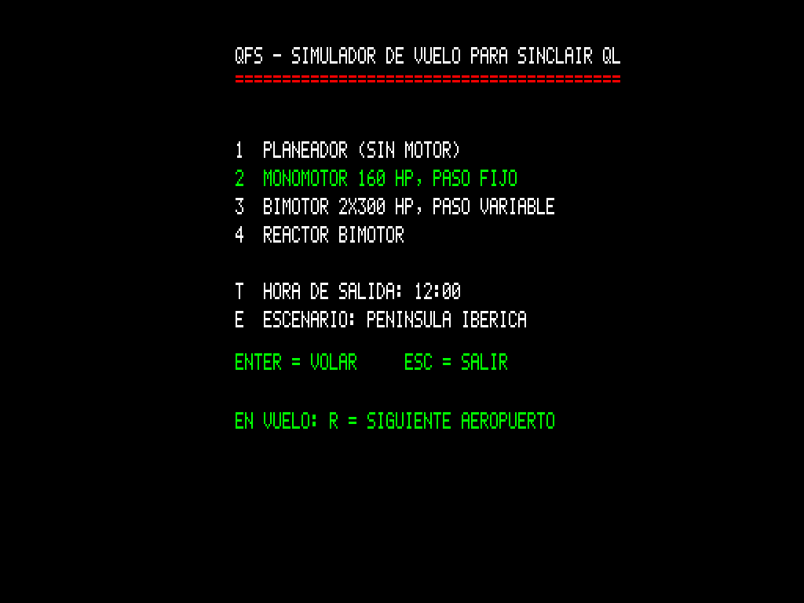
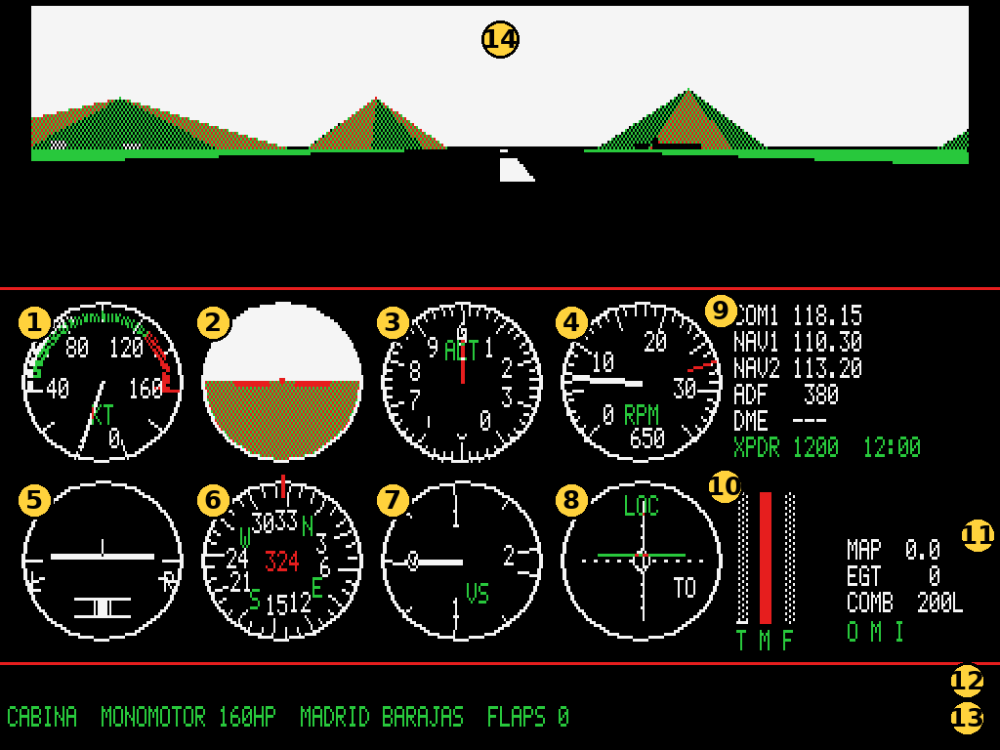
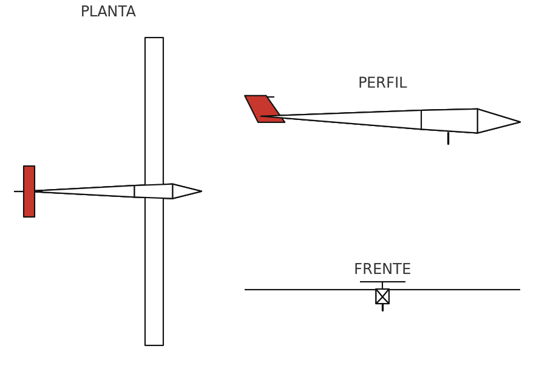
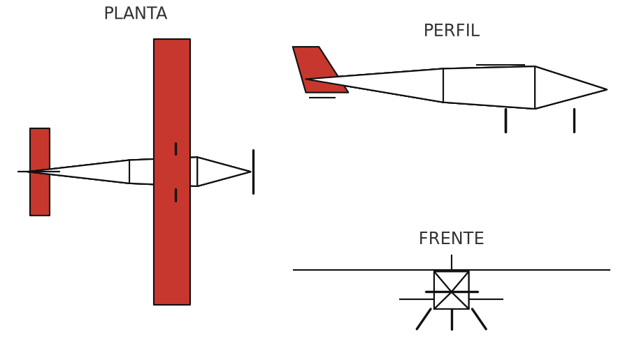
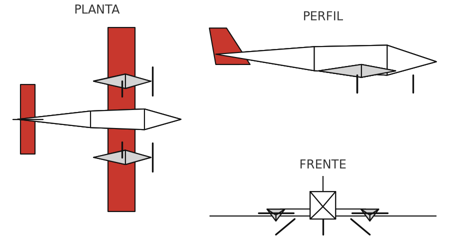
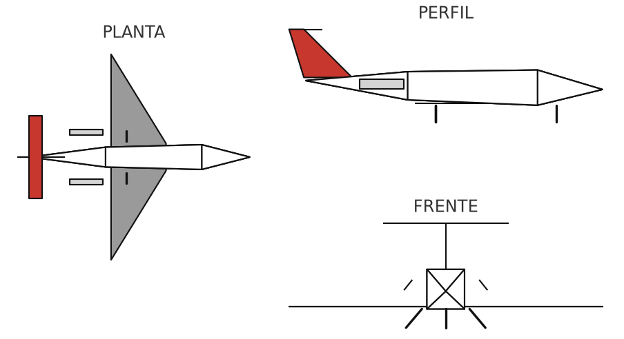
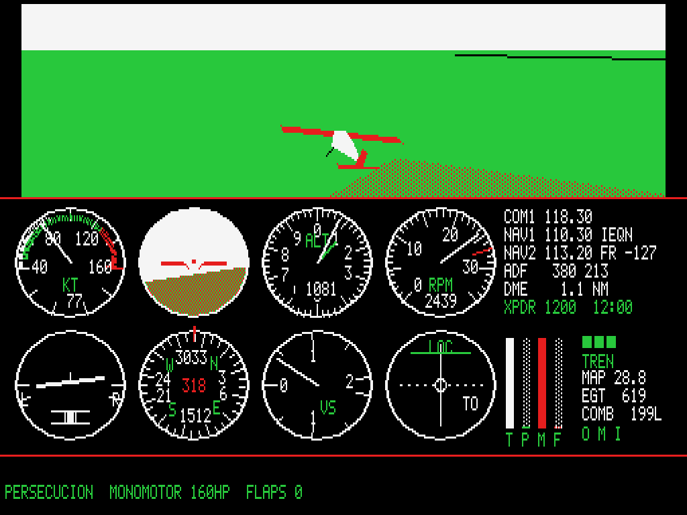

# Primeros pasos {#cap-inicio}

Alea's Flight Simulator (AFS) es un simulador de vuelo para el Sinclair QL. Pone cuatro aviones a tu disposición (un planeador, un monomotor, un bimotor y un reactor ejecutivo) y dos escenarios: un pequeño valle de pruebas y la Península Ibérica con sus catorce aeropuertos principales, radioayudas, ciudades y montañas.

Este capítulo explica lo mínimo para ponerlo en marcha. Los siguientes cuentan los menús, los aviones y cómo se vuela; al final del libro, en el anexo, tienes las listas de comprobación de cada avión.

## Qué necesitas

| Elemento | Requisito |
|:-------------|:-------------------------------------------------|
| Ordenador | Sinclair QL equipado con Super Gold Card (68020) o un emulador/compatible: sQLux, QPC2, QXL... que tenga al menos una velocidad x8 de un QL standar |
| Memoria | Al menos 640 KB (QL con ampliación de 512Kb). |
| Pantalla | Modo 4: 512×256 píxeles y 4 colores (negro, rojo, verde y blanco) |
| Almacenamiento | Disquete de doble densidad (720 KB) en `flp1_`, o disco duro/imagen QXL.WIN en `win1_`. No está preparado para microdrive: el escenario ibérico ocupa 450 KB. |
| Teclado | El del QL o compatible con IPC. |
| Sonido (opcional) | Tarjeta QSound 2+ (chip AY-3-8910). Sin ella el simulador funciona en silencio. |

## Qué contiene el disco

El juego se entrega en dos imágenes con el mismo contenido: `qfs.img` (disquete de 720 KB) y `qfs.win` (disco duro de 4 MB).

| Fichero | Contenido |
|:-----------|:---------------------------------------------|
| `boot` | Programa de arranque en SuperBASIC (4 líneas). |
| `qfs` | El simulador (ejecutable, 67 KB). |
| `iberia_scn` | Escenario Península Ibérica (450 KB). |
| `demo_scn` | Escenario de prueba «Valle del QL» (19 KB). |
| `planeador_acf`, `mono_acf`, `bimotor_acf`, `reactor_acf` | Los cuatro aviones. Son ficheros de texto que se pueden editar. |
| `planeador_src`, `mono_src`, `bimotor_src`, `reactor_src` | Fondo del panel de cada avión (formato RAW de de pantalla. |
| `<nombre>_sav` | Partidas guardadas con **G** en el menú, una por nombre (aparecen al guardar). |

## Cargarlo desde disquete

1. Inserta el disquete en la unidad 1 (`flp1_`).
2. Con el interfaz de disco que arranca desde `flp1_`, basta con reiniciar el QL y pulsar **F1** (monitor) o **F2** (televisión): el fichero `boot` se ejecuta solo.
3. Si tu interfaz no arranca solo, escribe:

```
LRUN flp1_boot
```

El programa pone el QL en modo 4, carga el simulador y muestra el menú. La carga tarda unos segundos.

## Cargarlo desde disco duro o QXL.WIN

Con la imagen `qfs.win` montada como `win1_` (por ejemplo, en un emulador, o copiada a un disco duro), escribe:

```
LRUN win1_boot
```

En sQLux basta con añadir al fichero de configuración una línea como `DEVICE = WIN1,/ruta/qfs.win,qdos-native`.

## Cargarlo desde otra unidad

El juego busca sus datos en la unidad que indica la variable `D$` del fichero `boot`. Si copias los ficheros a otra unidad (`flp2_`, `ram1_`, `win2_`...), edita el `boot` con las mismas dos líneas cambiadas:

```
100 REMark AFS - simulador de vuelo
110 D$ = "flp1_"
120 MODE 4
130 EXEC_W flp1_qfs
```

Cambia `flp1_` por tu unidad en las líneas 110 y 130.

::: {.aviso}
**Compatibilidad:** No necesita Toolkit II, al usar la variable `D$` es compatible con cualquier combinacion de ROM.
:::

## Si algo no va bien

| Síntoma | Causa probable |
|:-------------------------|:---------------------------------------------|
| «NO SE PUEDE ABRIR EL ESCENARIO» | Falta `iberia_scn` o `demo_scn` en la unidad indicada por `D$`. |
| «NO SE PUEDE LEER EL AVIÓN» | Falta alguno de los ficheros `*_acf`. |
| «FALTA EL FICHERO DEL PANEL (.SRC)» | Falta el `*_src` del avión elegido: el panel sale en negro. |
| «NO SE PUDO GUARDAR / CARGAR LA PARTIDA» | Disco lleno o protegido contra escritura; o la partida elegida es de otra máquina o versión. |
| El QL se queda en blanco al ejecutar | Revisa que la línea 130 del `boot` apunte a la unidad correcta. |
| Los colores salen distintos | Comprueba que el QL está en modo 4 (el `boot` lo hace con `MODE 4`). |

\newpage

# Los menús y las opciones {#cap-menus}

## El menú principal

Al arrancar aparece el menú de salida. Todo se maneja con el teclado y se actualiza al pulsar cada tecla.

{width=100%}

| Tecla | Opción |
|:----------------|:-------------------------------------------------------|
| **1** | Planeador (sin motor). |
| **2** | Monomotor de 160 HP, hélice de paso fijo. Es el avión por defecto. |
| **3** | Bimotor de 2×300 HP, hélice de paso variable y tren retráctil. |
| **4** | Reactor ejecutivo bimotor. |
| **T** / **Mayús+T** | Hora de salida: sube o baja una hora. Por defecto, las 12:00. |
| **E** | Escenario: alterna entre «Península Ibérica» (por defecto) y «Valle del QL (demo)». |
| **A** / **Mayús+A** | Aeropuerto de salida. |
| **S** / **Mayús+S** | Tipo de salida: «Continuar vuelo» (solo al volver de un vuelo, y es la opción que queda elegida; si cambias de avión con 1-4, el vuelo continúa con el avión nuevo, en la misma posición y actitud), en pista, en plataforma (la primera plataforma definida en el escenario; si no la tiene, junto a la pista), en vuelo (al azar, al 33 % del techo) o aterrizando. |
| **D** / **Mayús+D** | En pista: cabecera. Aterrizando: punto de la senda de 3° hacia la pista (a 20 NM, IF a 10 NM, FAF a 5 NM y «en corta final», a 1,5 NM) y, al acabar los de una pista, la siguiente cabecera. El avión sale a velocidad de planeo, con tren y flaps arriba. |
| **G** | Guarda el vuelo en curso en el disco. Pide un nombre (hasta 8 letras o cifras; **←** borra, **ENTER** guarda, **ESC** cancela) y crea el fichero `<nombre>_sav`. Si ya existe una partida con ese nombre, pregunta si se sobreescribe (**S** sí, **N** no, **ESC** cancela). Solo hay vuelo que guardar si se ha vuelto al menú desde uno. |
| **L** | Lista en pantalla las partidas guardadas en el disco de datos (por orden alfabético); se elige con **↑** y **↓**, **ENTER** la carga y sigue volando desde ella, **ESC** vuelve al menú. El fichero solo vale en la misma máquina y versión. |
| **ENTER** | Volar. |
| **ESC** | Salir al SuperBASIC. |

El avión elegido aparece en verde. Tras pulsar ENTER el programa carga el escenario y el avión; si falta algún fichero, muestra un aviso en rojo y vuelve al menú.

## La hora y la luz

La hora de salida (y la que luego avanza durante el vuelo) cambia el aspecto del cielo y del suelo:

| Hora | Luz |
|:-------------|:-------------------|
| 07:00 – 18:59 | Día |
| 06:00 – 06:59 y 19:00 – 20:59 | Atardecer o amanecer |
| 21:00 – 05:59 | Noche (se encienden las luces de pistas y ciudades, y las luces verdes de eje de las calles de rodaje) |

**Las estrellas.** De noche, y con menos estrellas al anochecer y al amanecer, el cielo lleva unas cien estrellas brillantes en su sitio de una noche de verano en Madrid: giran con la hora, cambian con el rumbo y la actitud del avión y las tapan las nubes y el horizonte. La ventana de la cabina solo abarca 12° hacia arriba, así que para verlas hay que mirar hacia arriba con **7**. Para encontrar el norte mira al rumbo 360 con el morro a 35°: la **Polar** queda casi en el centro, a unos 40° sobre el horizonte, y el Carro de la Osa Mayor y Casiopea giran a su alrededor. Con rumbo este y **7**, a las 22:00 verás Vega, Deneb y Altair (el Triángulo de Verano); mirando al sur, Escorpio con Antares, que es rojiza.

## Los escenarios

**Península Ibérica.** Catorce aeropuertos con torre, ATIS e ILS, además de unos veinte VOR/DME en ruta, nueve NDB, treinta y tres ciudades, ríos, autovías y las cadenas montañosas principales (Pirineos, Cantábrica, Sistema Central, Béticas, Canarias...). Se empieza en la cabecera de Madrid-Barajas.

::: {.aviso}
Las distancias del escenario están a escala 1:2, así que los vuelos duran la mitad. Los datos de coordenadas, rumbos y frecuencias son aproximados y están hechos para jugar: **no sirven para navegar de verdad**. El terreno es plano por teselas de 16 km: cada aeropuerto está a su altitud (Madrid, 610 m) y esa altitud se mantiene unos 40 km alrededor y baja hasta cero hacia fuera.
:::

| OACI | Aeropuerto | Pistas | Elev. (m) | ATIS | Torre | ILS (pista principal) |
|:--|:--------|:--|--:|:--|:--|:---------|
| LEMD | Madrid Barajas | 32L / 32R | 610 | 118.67 | 118.15 | 109.90 (32R: 111.90) |
| LEBL | Barcelona El Prat | 25R / 25L | 4 | 118.65 | 118.10 | 110.30 (25L: 108.30) |
| LEPA | Palma de Mallorca | 24L / 24R | 8 | 119.42 | 118.30 | 109.70 (24R: 108.10) |
| LEIB | Ibiza | 24 | 7 | 127.05 | 118.80 | 110.90 |
| LEVC | Valencia | 12 | 69 | 125.40 | 118.50 | 110.50 |
| LEMG | Málaga | 13L / 13R | 16 | 118.37 | 118.45 | 109.50 (13R: 111.50) |
| LEZL | Sevilla | 27 | 34 | 127.27 | 118.10 | 109.10 |
| LEST | Santiago | 17 | 370 | 120.62 | 118.75 | 110.70 |
| LEAS | Asturias | 29 | 127 | 118.97 | 118.15 | 109.30 |
| LPPT | Lisboa | 03 | 114 | 124.15 | 118.10 | 110.10 |
| GCTS | Tenerife Sur | 07 | 64 | 118.37 | 119.00 | 108.90 |
| GCFV | Fuerteventura | 01 | 26 | 120.05 | 118.25 | 108.70 |
| GCLP | Gran Canaria | 03L / 03R | 24 | 118.05 | 118.30 | 111.10 (03R: 111.70) |
| LEBB | Bilbao | 12 | 42 | 124.65 | 118.25 | 108.50 |

Madrid, Barcelona, Palma, Málaga y Gran Canaria tienen dos pistas paralelas, cada una con su ILS (en el número de pista se pinta la letra L o R). Cada aeropuerto tiene también su VOR/DME propio, PAPI en todas las cabeceras, y el número de pista pintado en el suelo.

**Valle del QL (demo).** Un escenario pequeño de tres aeropuertos para probar: «QL Norte» (con ILS en la pista 31), «QL Sur» y el «Aeródromo del Lago» (sin ATIS, torre en 122.80). Es muy ligero y carga al instante.

## La pantalla de vuelo

Al pulsar ENTER se pasa a la cabina. La pantalla se divide en la vista exterior (arriba) y el panel (abajo).

{width=100%}

| N.º | Elemento | Qué muestra |
|:--|:-----------|:---------------------------------------------------------|
| 1 | Anemómetro | Velocidad indicada en nudos. Los arcos de colores marcan los límites del avión (véase el capítulo siguiente). |
| 2 | Horizonte artificial | Actitud del avión: cabeceo y alabeo. |
| 3 | Altímetro | Altitud en pies: cifra digital, aguja corta verde (miles) y larga blanca (centenas). |
| 4 | Revoluciones | RPM del motor (escala ×100) o N1 % en el reactor. En bimotores hay dos agujas: blanca (motor izquierdo) y roja (derecho). |
| 5 | Coordinador de giro | Giro a la izquierda (L) o a la derecha (R). |
| 6 | Indicador de rumbo | Rosa de los vientos y rumbo actual en rojo. |
| 7 | Variómetro | Velocidad vertical en miles de pies por minuto. |
| 8 | CDI / ILS | Desviación lateral (barra vertical) y de senda (barra verde horizontal); indica `LOC` o `OBS`, y `TO`, `FR` u `OFF`. |
| 9 | Radios | COM1, NAV1, NAV2, ADF, DME, transpondedor y la hora. |
| 10 | Palancas | Barras **T**: gas, **P**: paso de hélice, **M**: mezcla y **F**: flaps. En los bimotores, T, P y M son dos barras finas (motor izquierdo y derecho). |
| 11 | Motor y tren | Luces del tren, MAP, EGT, combustible (FUEL), balizas (O M I) y aviso `PARADO`. |
| 12 | Mensajes de la torre | Texto del ATIS y del control, que se desplaza. |
| 13 | Línea de estado | Vista, avión, aeropuerto de salida, flaps y avisos. |
| 14 | Vista exterior | La escena 3D: cabina, persecución, torre o lateral. |

**La línea de estado** (13) muestra en verde la información normal, y en rojo los avisos:

| Aviso | Significado |
|:---------------|:-----------------------------------------------------|
| `PERDIDA!` | Estás a menos de 2° del ángulo de pérdida: el ala va a dejar de sustentar. |
| `TREN!` | Tren retráctil arriba a menos de 150 m del suelo. |
| `TIMON MANUAL` | Coordinación automática desactivada (tecla **Y**). |
| `PAUSA` | Simulación en pausa (**TAB**). |
| `PARADO` (panel) | El motor no está funcionando. |

**Las luces del tren** (11): tres cuadros. Verdes: tren abajo y bloqueado; rojos: en movimiento; apagados: arriba. En aviones de tren fijo siempre están verdes.

## Durante el vuelo

Las opciones del menú no se cambian en vuelo, pero sí estas:

| Tecla | Acción |
|:----------------|:-----------------------------------------------|
| **TAB** | Pausa. |
| **V** | Cambia de vista: cabina, persecución, torre, lateral. En las vistas exteriores el tren de los aviones retráctiles desaparece del dibujo cuando está recogido del todo. |
| **Q** | Mapa: el escenario visto desde arriba, norte arriba, a pantalla completa y con el avión en el centro. Marca NDB (círculo pequeño), VOR (círculo grande con un radio al norte), ILS (con su rumbo de aproximación) y aeropuertos (pistas, TWR y ATIS), con nombre, frecuencia y morse. El vuelo sigue de fondo; el mapa no se actualiza solo: se dibuja al abrirlo y al cambiar la escala con **+** / **-**. **Q** vuelve a la cabina. |
| **T** / **Mayús+T** | Hora +1 h / −1 h. |
| **R** / **Mayús+R** | Reinicia el vuelo en la cabecera del siguiente / anterior aeropuerto. |
| **ENTER** | Tras un choque, reinicia el vuelo. |
| **ESC** | Vuelve al menú de salida. |

\newpage

# Los aviones {#cap-aviones}

El simulador incluye cuatro aviones. Sus datos están en ficheros de texto (`*_acf`), así que se pueden retocar o añadir otros: basta con copiar uno y cambiar los valores.

## Resumen

| | Planeador | Monomotor | Bimotor | Reactor |
|:--------------|:-------:|:-------:|:-------:|:-------:|
| Tecla en el menú | 1 | 2 | 3 | 4 |
| Motores | — | 1 pistón | 2 pistón | 2 reactores |
| Potencia o empuje | — | 119 kW (160 HP) | 2 × 224 kW (300 HP) | 2 × 13 kN |
| Hélice | — | paso fijo | paso variable | — |
| Tren | fijo | fijo | retráctil | retráctil |
| Flaps | aerofrenos | 0 · 10 · 20 · 30 | 0 · 15 · 30 | 0 · 15 · 40 |
| Masa | 420 kg | 1000 kg | 2300 kg | 7000 kg |
| Combustible | — | 200 L | 520 L | 3000 L |
| Techo | 19 700 ft | 13 800 ft | 19 700 ft | 42 700 ft |

## Marcas del anemómetro

Cada avión lleva en el anemómetro sus propios arcos de velocidad (en nudos):

* **Arco blanco**: de `VS0` a `VFE`. Es el margen con flaps.
* **Arco verde**: de `VS1` a `VNO`. Vuelo normal.
* **Arco rojo**: de `VNO` a `VNE`. Solo con aire en calma.
* **Raya roja**: `VNE`, la velocidad que no se debe superar nunca.

| | Planeador | Monomotor | Bimotor | Reactor |
|:------------------------|:-----:|:-----:|:-----:|:-----:|
| `VS0` pérdida con flaps | 36 | 41 | 70 | 88 |
| `VS1` pérdida limpio | 38 | 48 | 80 | 102 |
| `VFE` máx. con flaps | 110 | 85 | 120 | 200 |
| `VNO` máx. normal | 100 | 128 | 195 | 300 |
| `VNE` no exceder | 135 | 160 | 225 | 330 |

::: {.aviso}
Si la velocidad supera `VNE` en más de un 12 %, el avión sufre **rotura estructural** y el vuelo termina.
:::

\newpage

## Planeador

{width=64%}

Un velero de entrenamiento: ligero, de ala larga y muy poca resistencia. No tiene motor, de modo que el vuelo es una continua conversión de altura en distancia. **Empieza en el aire**, a 600 m sobre el suelo, a unos 58 kt y a 4 km antes del umbral de la pista elegida; no hay remolque ni lanzamiento.

| Dato | Valor |
|:-----------------------|:----------------------------|
| Envergadura / longitud / altura | 17,0 m / 10,3 m / 1,8 m |
| Masa | 420 kg |
| Superficie alar | 13 m² |
| Mejor planeo (medido) | fineza ≈ 29, hacia 55 kt |
| Mejor planeo (calculado) | fineza máxima ≈ 32, a 50 kt |
| Pérdida | 36 kt con aerofrenos; 38 kt limpio |
| Aerofrenos | Tecla **F** los abre; **Mayús+F** los cierra |
| Tren | Fijo |
| Techo | 6000 m (19 700 ft) |

**Cómo se comporta.** Responde rápido a los mandos y pierde poca velocidad en los giros. Para aterrizar se apunta a la cabecera y se regula la senda con los aerofrenos: abiertos aumentan mucho la resistencia y la pendiente de descenso. Cualquier error de energía se paga: sin motor, no hay una segunda oportunidad.

\newpage

## Monomotor de 160 HP

{width=64%}

Un monoplano de ala alta de cuatro plazas, con motor de pistón de 160 HP, hélice de paso fijo y tren fijo. Es el avión ideal para empezar: estable, perdona los errores y vuela despacio.

| Dato | Valor |
|:-----------------------|:----------------------------|
| Envergadura / longitud / altura | 11,0 m / 9,7 m / 2,6 m |
| Masa | 1000 kg |
| Superficie alar | 16,2 m² |
| Motor | Pistón, 119 kW (160 HP), 2700 rpm máx., ralentí 650 rpm |
| Combustible | 200 L; consumo 38 L/h a plena potencia (≈ 5 h) |
| Flaps | 0, 10, 20 y 30° |
| Pérdida | 41 kt con flaps; 48 kt limpio |
| Mejor planeo (calculado) | ≈ 75 kt, fineza ≈ 13 |
| Carrera de despegue (medida) | ≈ 280 m |
| Subida (medida) | ≈ 1100 ft/min a 77 kt |
| Techo | 4200 m (13 800 ft) |

**Cómo se comporta.** Con la hélice de paso fijo, las RPM dependen del gas y de la velocidad: en picado suben mucho, así que vigila no pasarte del trazo rojo del cuentarrevoluciones. La mezcla se maneja con **M** y **Mayús+M**; con la barra al máximo el motor trabaja rico y cómodo. Si la mezcla baja demasiado o se acaba el combustible, el motor se para.

\newpage

## Bimotor de 2 × 300 HP

{width=64%}

Un bimotor ligero con hélices de velocidad constante y tren retráctil. Es más rápido y exigente que el monomotor: hay que gestionar tren, flaps, mezcla y paso de hélice.

| Dato | Valor |
|:-----------------------|:----------------------------|
| Envergadura / longitud / altura | 11,6 m / 10,6 m / 3,0 m |
| Masa | 2300 kg |
| Superficie alar | 18,5 m² |
| Motores | 2 × pistón, 224 kW (300 HP), 2700 rpm máx. |
| Hélices | Paso variable (palanca **P**) |
| Combustible | 520 L; 75 L/h por motor a plena potencia (≈ 3,5 h) |
| Flaps | 0, 15 y 30° |
| Tren | Retráctil (tecla **G**) |
| Pérdida | 70 kt con flaps; 80 kt limpio |
| Mejor planeo (calculado) | ≈ 100 kt con tren arriba, fineza ≈ 14 |
| Subida (medida) | ≈ 2500 ft/min a 135 kt |
| Techo | 6000 m (19 700 ft) |

**Cómo se comporta.** Los mandos de gas, mezcla y paso actúan sobre los dos motores a la vez. La palanca **P** es el paso de la pala. Con paso fino (barra vacía) la hélice carga poco el motor: RPM altas y máximo empuje a baja velocidad, para despegar y aterrizar, pero rinde mal rápido. Al engrosar el paso (**Mayús+P**) las RPM bajan, el motor consume menos y la hélice rinde más en crucero. Las RPM también dependen del gas y de la mezcla: el paso solo pone el tope. Sube el tren tras despegar y bájalo antes de aterrizar: con el tren arriba es un choque.

\newpage

## Reactor ejecutivo

{width=64%}

Un reactor ejecutivo de alas en flecha y motores en la cola. Despega en poco más de 600 m y sube a ritmos que un avión de hélice no alcanza: conviene planificar bien la aproximación, porque se frena despacio.

| Dato | Valor |
|:-----------------------|:----------------------------|
| Envergadura / longitud / altura | 15,0 m / 16,9 m / 5,0 m |
| Masa | 7000 kg |
| Superficie alar | 30 m² |
| Motores | 2 reactores, 13 kN de empuje cada uno |
| Combustible | 3000 L; 700 L/h por motor a plena potencia (≈ 2 h) |
| Flaps | 0, 15 y 40° |
| Tren | Retráctil (tecla **G**) |
| Pérdida | 88 kt con flaps; 102 kt limpio |
| Mejor planeo (calculado) | ≈ 140 kt, fineza ≈ 16 |
| Carrera de despegue (medida) | ≈ 650 m |
| Subida (medida) | más de 8000 ft/min tras el despegue |
| Techo | 13 000 m (42 700 ft) |

**Cómo se comporta.** En lugar de RPM, el panel muestra el **N1 %** (régimen del compresor), que tarda en subir y en bajar: da gas con antelación. El motor no se para por la mezcla, sino con la **palanca de corte** (**M** a cero) o por falta de combustible. En el panel, `EGT` es la temperatura de gases de escape y `FF` el consumo por motor en litros por hora.

\newpage

# Cómo volar {#cap-volar}

## Los mandos

El teclado se lee a la vez: puedes pulsar varias teclas simultáneamente (por ejemplo, alabeo y cabeceo). Para ahorrar tiempo, los cursores, ESPACIO, ENTER y ESC se leen en cada cuadro; F1-F4 y M, el punto y Z, cada dos cuadros; y el resto de las teclas, una fila por cuadro en rotación (cada cinco cuadros). Mantén pulsada la tecla un instante si no responde de inmediato.

### Mandos de vuelo

| Tecla | Acción |
|:----------------|:-------------------------------------------------------|
| **↑** | Empujar la palanca: morro abajo. |
| **↓** | Tirar de la palanca: morro arriba. El mando se queda donde lo dejas. |
| **←** / **→** | Alabeo a izquierda / derecha. Al soltar, los alerones vuelven al centro. |
| **Z** / **X** | Timón de dirección (izquierda / derecha), si el timón es manual. |
| **Y** | Conmuta la coordinación automática del timón. Si se desactiva, la línea de estado muestra `TIMON MANUAL`. |
| **ESPACIO** | Centra alerones, timón y profundidad. |
| **[** / **]** | Compensador (morro abajo / arriba), poco a poco. |

### Motor

| Tecla | Acción |
|:----------------|:-------------------------------------------------------|
| **F1** | Gas al ralentí (cortado). |
| **F2** | Menos gas, gradualmente. |
| **F3** | Más gas, gradualmente. |
| **F4** | Gas a fondo. |
| **M** / **Mayús+M** | Mezcla: empobrecer / enriquecer. A cero, el motor se para. |
| **P** / **Mayús+P** | Paso de la hélice (solo bimotor): más fino (más RPM, más empuje al despegue) / más grueso (menos RPM, mejor en crucero). |
| **E** | Arranque: mantenla pulsada (con mezcla > 5 % y combustible) para encender un motor parado. **Mayús+E** para el motor (en plataforma se sale con el motor parado). |

### Configuración del avión

| Tecla | Acción |
|:----------------|:-------------------------------------------------------|
| **F** | Un punto menos de flaps, hacia 0 (o cierra los aerofrenos del planeador). |
| **Mayús+F** | Un punto más de flaps (o abre los aerofrenos). |
| **G** | Sube o baja el tren (solo en aviones de tren retráctil). |
| **.** (punto) | Frenos de las ruedas, mientras se mantiene pulsada. |
| **Mayús+.** | Pone o quita el freno de estacionamiento (se sale de pista y de plataforma con él puesto). **BRK** en rojo en el panel, a la derecha de GEAR, con cualquiera de los dos frenos. |

### Vistas

| Tecla | Acción |
|:----------------|:-------------------------------------------------------|
| **V** | Cambia de vista: cabina, persecución, torre, lateral. |
| **5** / **4** / **6** / **8** | En cabina, mirar al frente / izquierda / derecha / atrás. |
| **7** / **9** | En cabina, mirar hacia arriba / abajo (35° por pulsación, hasta 70° arriba y 35° abajo; **5** vuelve al frente). |
| **=** / **−** | Zoom: acerca / aleja la cámara. |

### Radios y navegación

Cada pulsación cambia la frecuencia un paso; con **Mayús** va en sentido contrario. Al llegar al límite, da la vuelta.

| Tecla | Acción |
|:----------------|:-------------------------------------------------------|
| **C** | COM1: 118,00 – 136,95 MHz, pasos de 0,05. |
| **N** | NAV1: 108,00 – 117,95 MHz, pasos de 0,05. |
| **H** | NAV2: 108,00 – 117,95 MHz, pasos de 0,05. |
| **A** | ADF: 190 – 1750 kHz, pasos de 5 kHz. |
| **O** / **Mayús+O** | OBS (rumbo del VOR): mantenla pulsada para girarlo. |
| **K** | Llamar a la torre. |

### Simulación

| Tecla | Acción |
|:----------------|:-------------------------------------------------------|
| **TAB** | Pausa. |
| **T** / **Mayús+T** | Hora +1 h / −1 h. |
| **R** / **Mayús+R** | Reinicia el vuelo en el aeropuerto siguiente / anterior. |
| **\\** (barra invertida) | Muestra u oculta el indicador de cuadros por segundo (abajo a la izquierda). |
| **ENTER** | Tras un choque, reinicia el vuelo. |
| **ESC** | Sale al menú. |

## Configuraciones útiles

**Coordinación automática (Y).** Por defecto el simulador coordina el timón con los alerones, y en tierra, los alerones (**←** y **→**) giran la rueda de morro. Si la desactivas con **Y**, el timón pasa a **Z** y **X**, y es lo que gira la rueda en tierra.

**Compensador.** Si te cansas de mantener el cabeceo, corrige la actitud y ajusta el compensador con **[** y **]** hasta que el avión vuele solo.

**Vistas.** La vista de cabina es la de trabajo; **persecución**, **torre** y **lateral** sirven para ver el avión desde fuera y para el espectáculo. Pulsa **V** hasta volver a la cabina antes de aterrizar con instrumentos.

**Viento.** Sopla siempre del norte a 6 kt. La torre lo comunica y elige la pista en uso.

**Visibilidad.** El escenario ibérico tiene una visibilidad de 40 km; más allá, el suelo se difumina en neblina.

{width=85%}

## Un vuelo paso a paso

**1. Antes de moverte.** Mira el panel: COM1 ya está en la frecuencia de la torre, y NAV1 se sintoniza al ILS de la pista si quieres usarlo. Comprueba mezcla, combustible, flaps y compensador (véanse las listas del anexo). Con el avión parado y la torre sintonizada, pulsa **K**: «CLEARED FOR TAKEOFF» si estás por debajo de 20 kt.

**2. Rodar y despegar.** Suelta los frenos, da gas a fondo (**F4**) y mantén el eje de la pista con **←** y **→**. A la velocidad de rotación de tu avión (véanse las listas) tira suavemente (**↓**) hasta unos 8–10° de cabeceo. Cuando el variómetro marque ascenso, recoge el tren (**G**, solo en los aviones retráctiles).

**3. Subir.** Mantén la velocidad de subida con el cabeceo, no con el gas. Retira los flaps al llegar a unos 400 ft sobre el terreno y velocidad suficiente. Reduce el gas a la potencia de subida o de crucero.

**4. Crucero.** Nivela, ajusta la potencia, compensa y comprueba rumbo con el indicador y las radioayudas (VOR, ADF, DME).

**5. Descender y aproximar.** Reduce gas, deja que baje el morro y sintoniza el ATIS (**C**) para saber la pista en uso. Con NAV1 en el ILS (**N**), el CDI (8) te guía en lateral y en senda. A 25 km de la pista pulsa **K**: la torre te pedirá avisar a 5 millas de final.

**6. Aterrizar.** Baja el tren y los flaps escalonadamente por debajo de `VFE`. Mantén la senda, reduce a ralentí al empezar la nivelación y toca con suavidad: la velocidad de descenso en el contacto no debe superar los 3,5 m/s (unos 690 ft/min), con las alas casi niveladas y el morro no por debajo de 4° de actitud negativa. Frena con **.** y la torre te recibirá: «WELCOME TO… TAXI TO PARKING».

**7. Rodar y parar.** Reduce a menos de 25 kt, sal de la pista y frena.

## Instrumentos de navegación

**ILS.** Sintoniza en NAV1 la frecuencia del localizador de la pista (véase la tabla de aeropuertos). El CDI (8) pasa a mostrar `LOC`: la barra vertical indica si estás a izquierda o derecha de la pista, y la barra verde horizontal si estás por encima o por debajo de la senda de 3°. El objetivo es mantener las dos barras centradas. El DME indica la distancia al aeropuerto en millas náuticas. Al pasar sobre las balizas, se encienden las luces **O** (exterior), **M** (media) e **I** (interior) del panel (11).

**VOR.** Sintoniza un VOR en NAV1 o NAV2. El CDI muestra `OBS` con el rumbo seleccionado (se cambia con **O**), la barra de desviación, y la bandera `TO` (te acercas a la estación), `FR` (te alejas) u `OFF` (sin señal).

**ADF.** Sintoniza un NDB con **A**. El panel muestra la frecuencia y el rumbo relativo a la estación (en grados, respecto a la proa).

**Transpondedor.** Aparece el código 1200 (VFR), que la torre repite en el contacto por radar.

## El control de tráfico

La torre y el ATIS hablan en inglés, como en la aviación real. Sus mensajes aparecen desplazándose en la línea 12 del panel.

**ATIS.** Sintoniza la frecuencia ATIS de un aeropuerto en COM1 estando a menos de 60 km. El mensaje (pista en uso, viento, altímetro, ILS) se repite hasta que cambies de frecuencia.

**Torre.** Sintoniza la frecuencia de torre en COM1 (al empezar ya está puesta) y pulsa **K**:

| Situación | Respuesta de la torre |
|:-----------------------------|:--------------------------------------------------|
| En tierra, a menos de 20 kt | `CLEARED FOR TAKEOFF` (con pista y viento). |
| En tierra, a más de 20 kt | `HOLD SHORT, STOP BEFORE CALLING.` |
| En el aire, a menos de 9 km, en línea con la pista | `CLEARED TO LAND` |
| En el aire, a menos de 9 km, fuera de línea | `ENTER DOWNWIND, REPORT FINAL.` |
| En el aire, de 9 a 25 km | `ALTIMETER 2992, REPORT 5 MILES FINAL.` |
| En el aire, a más de 25 km (hasta 60) | `RADAR CONTACT, SQUAWK …, FLY HEADING …, VECTORS TO …` |
| Frecuencia que no es de ATIS ni de torre | `NO REPLY ON THIS FREQUENCY.` |

También hay mensajes automáticos: `CONTACT DEPARTURE. GOOD DAY.` al salir de la zona tras despegar; `WELCOME TO … TAXI TO PARKING.` al aterrizar y frenar por debajo de 25 kt, y `YOU WERE NOT CLEARED. CONTACT THE TOWER.` si aceleras o aterrizas sin autorización.

## Choques y reinicio

El vuelo termina con un mensaje rojo y, al pulsar **ENTER**, vuelves a la cabecera.

| Mensaje | Causa |
|:-----------------------------------|:-----------------------------------------------|
| `CRASH! - BAJE EL TREN LA PROXIMA VEZ` | Aterrizar con el tren retráctil subido. |
| `CRASH!` | Contacto con el suelo demasiado duro: descenso de más de 3,5 m/s, alabeo de más de 12° o morro por debajo de −4°. |
| `BUILDING CRASH` | Chocar con un edificio. |
| `MOUNTAIN CRASH` | Chocar con una montaña. |
| `SPLASH!` | Tocar el agua. |
| `ROTURA ESTRUCTURAL - VNE EXCEDIDA` | Superar `VNE` en más de un 12 %. |

\newpage

\appendix
\AtBeginEnvironment{longtable}{\footnotesize}

# Listas de comprobación

Cada avión tiene siete listas, una por cada fase: preparar para despegar, despegar, crucero, preparar para aterrizar, aterrizar, rodaje y emergencias. Las velocidades son orientativas, calculadas a partir de las de pérdida de cada avión (`VS0`, `VS1`) y de sus límites (`VFE`, `VNO`, `VNE`).

El símbolo □ es para marcar con un lápiz sobre el papel. Las teclas aparecen en **negrita**.

\newpage

## Planeador

El planeador empieza ya en el aire, a unos 58 kt y 600 m de altura, a 4 km de la pista: no tiene fases de rodaje ni de despegue propias, así que sus listas son las del vuelo.

### Preparar la salida

| | | |
|:-:|:------------------|:-----------------------------|
| □ | Avión | **1** en el menú |
| □ | Hora | **T**: luz de día para empezar |
| □ | Aerofrenos | Cerrados (barra **F** vacía) |
| □ | Altímetro | Anota la altura: 2000 ft aprox. |
| □ | Velocidad | 55 kt, mejor planeo |
| □ | Radio COM1 | En la torre de la pista (ya puesta) |
| □ | Radio NAV1 | ILS de la pista, si lo quieres usar |

### Despegar (inicio del vuelo)

| | | |
|:-:|:------------------|:-----------------------------|
| □ | Mandos | **ESPACIO**: centrados |
| □ | Actitud | Morro en el horizonte |
| □ | Velocidad | 55–60 kt y estable |
| □ | Compensador | Ajusta con **[** y **]** hasta que vuele solo |
| □ | Entorno | Busca la pista al frente |

### Crucero

| | | |
|:-:|:------------------|:-----------------------------|
| □ | Velocidad | 55 kt (mejor planeo); 70–80 kt para ir más rápido |
| □ | Aerofrenos | Cerrados |
| □ | Rumbo | Hacia la pista, con ← y → suaves |
| □ | Altura | Controla ALT; la fineza es de ≈ 29 |
| □ | Límites | Por debajo de 100 kt (arco verde) |

\newpage

### Preparar el aterrizaje

| | | |
|:-:|:------------------|:-----------------------------|
| □ | Torre | **K** a menos de 25 km |
| □ | Circuito | Alinéate con la pista antes de 9 km |
| □ | Velocidad | 60 kt en final |
| □ | Senda | Apunta a un punto antes de la pista |
| □ | Aerofrenos | Prepara la mano en **F** |

### Aterrizar

| | | |
|:-:|:------------------|:-----------------------------|
| □ | Torre | **K**: «CLEARED TO LAND» |
| □ | Aerofrenos | **F** si vas alto; **Mayús+F** si vas bajo |
| □ | Nivelación | Sobre la pista, morro arriba suave |
| □ | Contacto | Menos de 3,5 m/s, alas niveladas |
| □ | Frenos | **.** (punto) |

### Rodaje

| | | |
|:-:|:------------------|:-----------------------------|
| □ | Aerofrenos | Abiertos para no volver al aire |
| □ | Frenos | **.** (punto) hasta parar |
| □ | Dirección | **←** y **→** (o **Z**/**X** en manual) |
| □ | Torre | «WELCOME TO…» al bajar de 25 kt |

### Emergencias

| | | |
|:-:|:------------------|:-----------------------------|
| □ | Pérdida (`PERDIDA!`) | **↑**: baja el morro; alas niveladas; cierra aerofrenos |
| □ | Corto de altura | Elige el campo más cercano o el aeropuerto |
| □ | Sin torre | Aterriza en cualquier pista, sin esperar |
| □ | Exceso de velocidad | Aerofrenos abiertos, sube el morro suavemente |

\newpage

## Monomotor de 160 HP

### Preparar el despegue

| | | |
|:-:|:------------------|:-----------------------------|
| □ | Combustible | FUEL ≈ 200 L |
| □ | Mezcla | Al máximo (barra **M** llena: **Mayús+M**) |
| □ | Gas | **F1**: ralentí, ≈ 650 rpm |
| □ | Flaps | 10°: **F** una vez |
| □ | Mandos | **ESPACIO**: centrados; compensador neutro |
| □ | Rumbo | Indicador (6) = rumbo de pista |
| □ | Altímetro | Comprueba la elevación del campo |
| □ | Radios | COM1 en la torre; NAV1 en el ILS |
| □ | ATIS | Escucha pista y viento |
| □ | Frenos | Freno de estacionamiento (**Mayús+.**) mientras esperas |

### Despegar

| | | |
|:-:|:------------------|:-----------------------------|
| □ | Torre | **K**: «CLEARED FOR TAKEOFF» |
| □ | Frenos | Quita el de estacionamiento con **Mayús+.**: el **BRK** rojo se apaga |
| □ | Gas | **F4**: a fondo |
| □ | Eje de la pista | **←** y **→** |
| □ | Rotación | 55 kt: **↓** suave, 8–10° |
| □ | Ascenso positivo | Variómetro (7) > 0 |
| □ | Velocidad de subida | 75–80 kt |
| □ | Flaps | **Mayús+F** a 400 ft AGL y 65 kt |

### Crucero

| | | |
|:-:|:------------------|:-----------------------------|
| □ | Altitud | Nivela y compensa |
| □ | Potencia | **F2**: RPM bajo el trazo rojo (< 2700) |
| □ | Mezcla | Rica (barra llena) |
| □ | Velocidad | ≈ 110 kt, dentro del arco verde (48–128 kt) |
| □ | Combustible | Vigila FUEL |
| □ | Navegación | VOR/ADF/DME; rumbo con el indicador (6) |

\newpage

### Preparar el aterrizaje

| | | |
|:-:|:------------------|:-----------------------------|
| □ | ATIS | Pista en uso y viento |
| □ | Torre | **K** a menos de 25 km |
| □ | Descenso | Gas bajo, 90 kt hasta el circuito |
| □ | Mezcla | Rica |
| □ | Flaps | 10° a ≤ 85 kt: **F** |
| □ | ILS | NAV1 en el localizador |
| □ | Final | 65 kt, flaps 20° |

### Aterrizar

| | | |
|:-:|:------------------|:-----------------------------|
| □ | Torre | **K**: «CLEARED TO LAND» |
| □ | Flaps | 30° en final corta, 60 kt |
| □ | Senda | 3°: barras del CDI centradas |
| □ | Gas | **F1** al nivelar |
| □ | Contacto | ≈ 50 kt, menos de 3,5 m/s |
| □ | Frenos | **.** (punto) |

### Rodaje

| | | |
|:-:|:------------------|:-----------------------------|
| □ | Flaps | **Mayús+F** hasta 0 |
| □ | Gas | Ralentí; < 25 kt |
| □ | Dirección | **←** y **→** |
| □ | Torre | «WELCOME TO… TAXI TO PARKING» |
| □ | Parada | **.** (punto) |

### Emergencias

| | | |
|:-:|:------------------|:-----------------------------|
| □ | Motor parado | Baja el morro: 70 kt (mejor planeo) |
| □ | Reencender | Mezcla rica (**Mayús+M**), gas medio, **E** pulsada |
| □ | Sin combustible | FUEL en rojo: aterriza en cuanto puedas |
| □ | Pérdida (`PERDIDA!`) | **↑** baja el morro, gas a fondo, alas niveladas |
| □ | Exceso de velocidad | Gas a ralentí, sube el morro (VNE 160 kt) |
| □ | Frustrada | **F4**, morro a 8°, flaps 10° |

\newpage

## Bimotor de 2 × 300 HP

### Preparar el despegue

| | | |
|:-:|:------------------|:-----------------------------|
| □ | Combustible | FUEL ≈ 520 L |
| □ | Mezcla | Al máximo (barra **M** llena) |
| □ | Paso de hélice | Fino: **P** (barra **P** vacía) |
| □ | Gas | **F1**: ralentí, ≈ 650 rpm los dos |
| □ | Tren | Abajo y bloqueado: 3 luces verdes |
| □ | Flaps | 15°: **F** una vez |
| □ | Mandos | **ESPACIO**; compensador neutro |
| □ | Rumbo | Indicador (6) = rumbo de pista |
| □ | Radios | COM1 en la torre; NAV1 en el ILS |
| □ | Frenos | **.** (punto) mientras esperas |

### Despegar

| | | |
|:-:|:------------------|:-----------------------------|
| □ | Torre | **K**: «CLEARED FOR TAKEOFF» |
| □ | Frenos | Suelta **.** (punto) |
| □ | Gas | **F4**: a fondo |
| □ | Dirección | Eje con **←** y **→** |
| □ | Rotación | 95 kt: **↓** suave, 8–10° |
| □ | Ascenso positivo | Variómetro (7) > 0 → **G**: tren arriba |
| □ | Velocidad de subida | 130–140 kt |
| □ | Flaps | **Mayús+F** a 400 ft AGL |

### Crucero

| | | |
|:-:|:------------------|:-----------------------------|
| □ | Altitud | Nivela y compensa |
| □ | Potencia | **F2**: ~75 % |
| □ | Paso de hélice | **Mayús+P**: paso medio, RPM de crucero bajo la raya roja |
| □ | Mezcla | Rica; empobrece **M** para ahorrar |
| □ | Velocidad | Dentro del arco verde (80–195 kt) |
| □ | Combustible | Vigila FUEL (3,5 h a plena potencia) |
| □ | Tren | Arriba |

\newpage

### Preparar el aterrizaje

| | | |
|:-:|:------------------|:-----------------------------|
| □ | ATIS y torre | **C** → ATIS; **K** a menos de 25 km |
| □ | Descenso | Gas bajo, 140 kt hasta el circuito |
| □ | Mezcla | Rica |
| □ | Paso de hélice | Fino (**P**) |
| □ | Flaps | 15° a ≤ 120 kt: **F** |
| □ | Tren | **G**: abajo, 3 luces verdes (≤ 120 kt) |
| □ | Final | 95 kt, flaps 15° |

### Aterrizar

| | | |
|:-:|:------------------|:-----------------------------|
| □ | Torre | **K**: «CLEARED TO LAND» |
| □ | Flaps | 30° en final corta, 85–90 kt |
| □ | Tren | Verifica: sin `TREN!` |
| □ | Senda | 3°: barras del CDI centradas |
| □ | Gas | **F1** al nivelar |
| □ | Contacto | Menos de 3,5 m/s, alas niveladas |
| □ | Frenos | **.** (punto) |

### Rodaje

| | | |
|:-:|:------------------|:-----------------------------|
| □ | Flaps | **Mayús+F** hasta 0 |
| □ | Gas | Ralentí; < 25 kt |
| □ | Dirección | **←** y **→** |
| □ | Torre | «WELCOME TO… TAXI TO PARKING» |
| □ | Parada | **.** (punto) |

### Emergencias

| | | |
|:-:|:------------------|:-----------------------------|
| □ | Motores parados | Morro abajo: 100 kt, tren arriba |
| □ | Reencender | Mezcla rica, paso fino, **E** pulsada |
| □ | Sin combustible | FUEL en rojo: aterriza ya |
| □ | Tren sin bajar | `TREN!` en rojo: **G** y comprueba 3 luces verdes |
| □ | Pérdida (`PERDIDA!`) | **↑**, gas a fondo, alas niveladas |
| □ | Exceso de velocidad | Gas a ralentí, sube el morro (VNE 225 kt) |
| □ | Frustrada | **F4**, 8°, flaps 15°, tren arriba |

*Nota:* los mandos del simulador actúan sobre los dos motores a la vez, así que no se puede simular el fallo de uno solo.

\newpage

## Reactor ejecutivo

### Preparar el despegue

| | | |
|:-:|:------------------|:-----------------------------|
| □ | Combustible | FUEL ≈ 3000 L |
| □ | Palanca de corte | **Mayús+M**: abierta (barra **M** llena) |
| □ | Motores | N1 ≈ 22 % los dos, sin `PARADO` |
| □ | Gas | **F1**: ralentí |
| □ | Tren | Abajo y bloqueado: 3 luces verdes |
| □ | Flaps | 15°: **F** una vez |
| □ | Mandos | **ESPACIO**; compensador neutro |
| □ | Rumbo | Indicador (6) = rumbo de pista |
| □ | Radios | COM1 en la torre; NAV1 en el ILS |
| □ | Frenos | **.** (punto) mientras esperas |

### Despegar

| | | |
|:-:|:------------------|:-----------------------------|
| □ | Torre | **K**: «CLEARED FOR TAKEOFF» |
| □ | Frenos | Suelta **.** (punto) |
| □ | Gas | **F4**: a fondo; N1 sube con retardo |
| □ | Dirección | Eje con **←** y **→** |
| □ | Rotación | 120 kt: **↓** suave, 10–12° |
| □ | Ascenso positivo | Variómetro (7) > 0 → **G**: tren arriba |
| □ | Velocidad de subida | 200–250 kt |
| □ | Flaps | **Mayús+F** hasta 0 sobre 1000 ft AGL |

### Crucero

| | | |
|:-:|:------------------|:-----------------------------|
| □ | Altitud | Nivela y compensa |
| □ | Potencia | **F2**: N1 por debajo del 100 % |
| □ | Velocidad | IAS por debajo de VNO (300 kt) |
| □ | EGT y FF | Dentro de lo normal; vigila FF |
| □ | Combustible | FUEL; ≈ 2 h a plena potencia |
| □ | Navegación | VOR/ADF/DME; rumbo con el indicador (6) |
| □ | Tren | Arriba |

\newpage

### Preparar el aterrizaje

| | | |
|:-:|:------------------|:-----------------------------|
| □ | ATIS y torre | **C** → ATIS; **K** a menos de 25 km |
| □ | Descenso | Gas bajo, 250 kt hasta 40 km |
| □ | Flaps | 15° a ≤ 200 kt: **F** |
| □ | Tren | **G**: abajo, 3 luces verdes (≤ 200 kt) |
| □ | ILS | NAV1 en el localizador |
| □ | Final | 135 kt |

### Aterrizar

| | | |
|:-:|:------------------|:-----------------------------|
| □ | Torre | **K**: «CLEARED TO LAND» |
| □ | Flaps | 40° en final corta, 125 kt |
| □ | Tren | Verifica: sin `TREN!` |
| □ | Senda | 3°: barras del CDI centradas |
| □ | Gas | **F1** al nivelar; el N1 baja despacio |
| □ | Contacto | ≈ 115 kt, menos de 3,5 m/s |
| □ | Frenos | **.** (punto) |

### Rodaje

| | | |
|:-:|:------------------|:-----------------------------|
| □ | Flaps | **Mayús+F** hasta 0 |
| □ | Gas | Ralentí; < 25 kt |
| □ | Dirección | **←** y **→** |
| □ | Torre | «WELCOME TO… TAXI TO PARKING» |
| □ | Parada | **.** (punto) |

### Emergencias

| | | |
|:-:|:------------------|:-----------------------------|
| □ | Motores parados | Morro abajo: 140 kt, tren arriba |
| □ | Reencender | Palanca de corte abierta (**Mayús+M**), **E** pulsada |
| □ | Sin combustible | FUEL en rojo: aterriza ya |
| □ | Tren sin bajar | `TREN!` en rojo: **G** y comprueba 3 luces verdes |
| □ | Pérdida (`PERDIDA!`) | **↑**, gas a fondo, alas niveladas |
| □ | Exceso de velocidad | Gas a ralentí, sube el morro (VNE 330 kt) |
| □ | Frustrada | **F4**, 10°, flaps 15°, tren arriba |

\clearpage

```{=latex}
\includepdf[pages=1,fitpaper=true]{img/teclado_ql.pdf}
```
